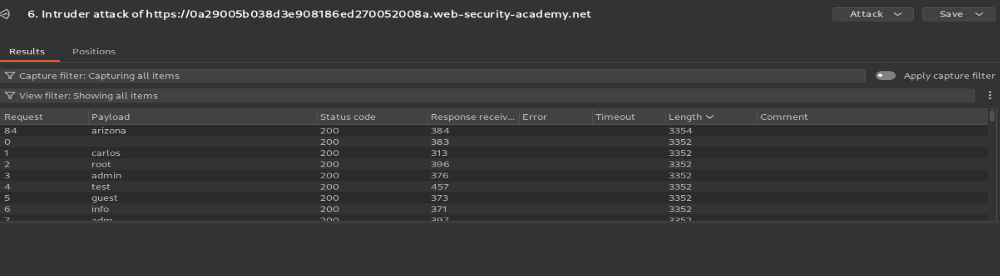
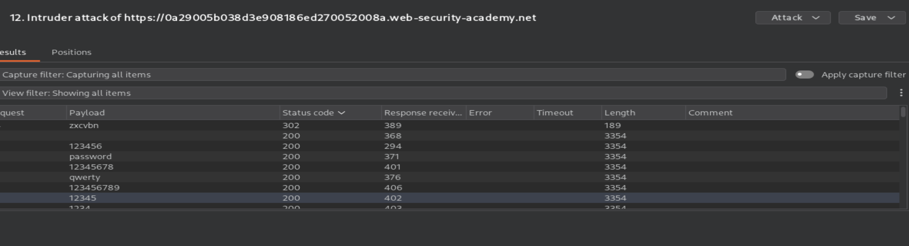
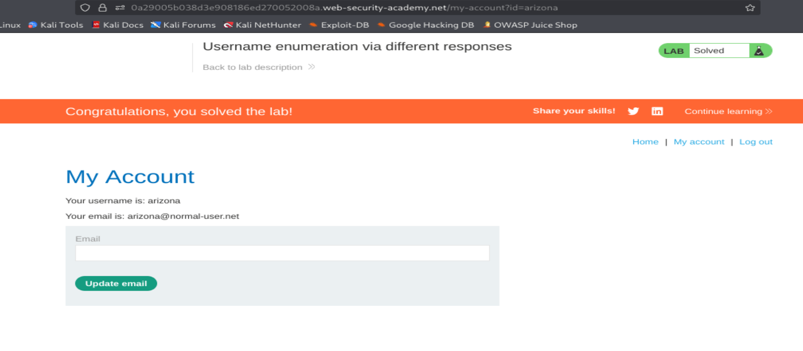

# Authentication: Username Enumeration via Different Responses

## Lab Information
- **Platform:** PortSwigger Web Security Academy
- **Category:** Authentication
- **Difficulty:** Apprentice
- **Status:** Solved
- **Tools:** Burp Suite Proxy, Burp Suite Intruder

## Vulnerability Overview

Username enumeration occurs when an application reveals whether a username exists through differences in authentication responses.

In this lab, different response lengths helped identify a valid username.

## Testing Process

1. Open the assigned PortSwigger lab in a browser.
2. Navigate to the login page.
3. Intercept a login request using Burp Suite Proxy.
4. Send the intercepted request to Burp Suite Intruder.
5. Configure the username parameter as the payload position.
6. Load the candidate username list as the payload set and run the attack.
7. Compare response lengths to identify a potential valid username.
8. Use the identified username in a new Intruder attack, configuring the password parameter as the payload position.
9. Load the candidate password list and analyse the responses, looking for HTTP status code `302` as an indicator of a potentially successful login.
10. Use the identified credentials to log in to the authorised lab and confirm successful completion.

## Evidence

### Username Enumeration

### Password Attack

### Lab Completion

## Impact

- Reveals valid usernames.
- Can facilitate targeted password guessing and credential attacks.
- May increase the risk of unauthorised account access.

## Remediation

- Use generic login error messages for invalid usernames and passwords.
- Apply rate limiting to login attempts.
- Monitor suspicious authentication activity.
- Implement multi-factor authentication (MFA).

## References

- [PortSwigger: Username Enumeration](https://portswigger.net/web-security/authentication/password-based/lab-username-enumeration-via-different-responses)
- [OWASP: Authentication Cheat Sheet](https://cheatsheetseries.owasp.org/cheatsheets/Authentication_Cheat_Sheet.html)
