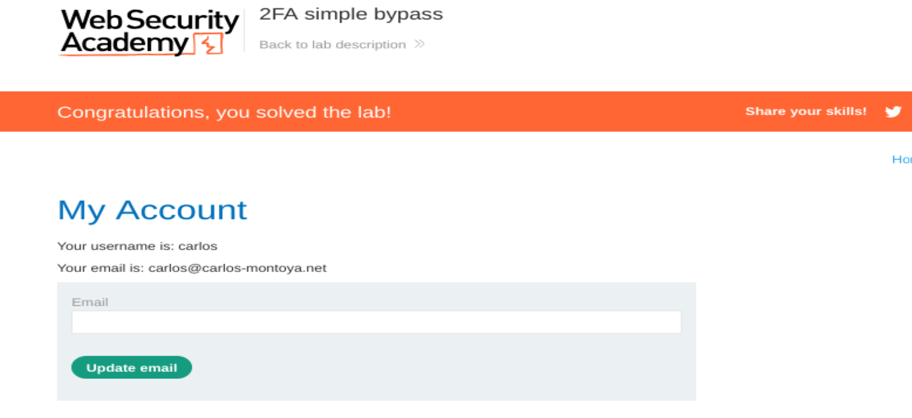

# Authentication: 2FA Simple Bypass

## Lab Information
- **Platform:** PortSwigger Web Security Academy
- **Category:** Authentication
- **Difficulty:** Apprentice
- **Status:** Solved
- **Tools:** Web Browser, Burp Suite Proxy

## Vulnerability Overview

Two-factor authentication (2FA) adds an additional layer of security by requiring users to verify their identity using a second authentication factor.

A 2FA bypass vulnerability occurs when an application fails to properly enforce the verification step before granting access to protected resources.

In this lab, the application allowed users to access the account page by directly navigating to `/my-account` without completing the 2FA verification process.

## Testing Process

1. Log in to your own account using the provided credentials.
2. Retrieve the 2FA verification code from the lab's email client.
3. Complete the 2FA verification process and navigate to the account page.
4. Make a note of the account page URL and log out.
5. Log in using the victim's credentials and stop at the 2FA verification page.
6. Manually modify the browser URL to navigate directly to `/my-account`, bypassing the 2FA verification step.
7. Confirm that the victim's account page loads without completing 2FA, demonstrating the vulnerability and solving the lab.

## Evidence

### Lab Completion

## Impact

- Allows attackers to bypass the second authentication factor.
- Enables unauthorised access to protected user accounts.
- Weakens the overall security provided by multi-factor authentication.
- May expose sensitive account information and functionality.

## Remediation

- Enforce 2FA verification on the server side before granting access to protected resources.
- Ensure authentication state is maintained across all application endpoints.
- Restrict access to protected pages until all authentication factors are successfully verified.
- Validate the user's authentication status on every protected request.
- Implement secure session management and appropriate authorization checks.

## References

- [PortSwigger: 2FA Simple Bypass](https://portswigger.net/web-security/authentication/multi-factor/lab-2fa-simple-bypass)
- [OWASP: Authentication Cheat Sheet](https://cheatsheetseries.owasp.org/cheatsheets/Authentication_Cheat_Sheet.html)