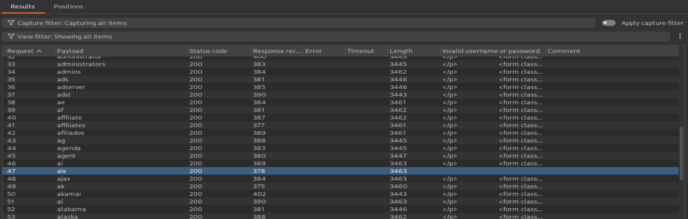
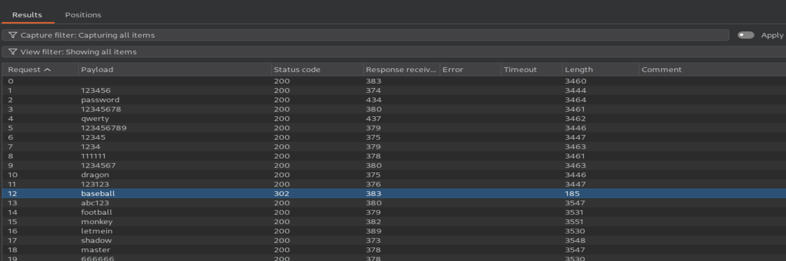

# Authentication: Username Enumeration via Subtly Different Responses

## Lab Information
- **Platform:** PortSwigger Web Security Academy
- **Category:** Authentication
- **Difficulty:** Apprentice
- **Status:** Solved
- **Tools:** Burp Suite Proxy, Burp Suite Intruder

## Vulnerability Overview

Username enumeration occurs when an application unintentionally reveals whether a username exists through subtle differences in authentication responses.

In this lab, a minor difference in the login error message helped identify a valid username. The application returned `Invalid username or password.` for invalid usernames, while one response contained `Invalid username or password` without the trailing full stop (`.`).

## Testing Process

1. Open the assigned PortSwigger lab in a browser.
2. Navigate to the login page.
3. Intercept a login request using Burp Suite Proxy.
4. Send the intercepted request to Burp Suite Intruder.
5. Configure the username parameter as the payload position.
6. Load the candidate username list as the payload set.
7. Navigate to the **Settings** section and configure **Grep - Extract** to extract the login error message `Invalid username or password.` from the responses.
8. Run the attack and analyse the extracted responses to identify the subtle difference in the error message. The response without the trailing full stop indicates a potentially valid username.
9. Use the identified username in a new Intruder attack, configuring the password parameter as the payload position.
10. Load the candidate password list and analyse the responses, looking for HTTP status code `302` as an indicator of a potentially successful login.
11. Use the identified credentials to log in to the authorised lab and confirm successful completion.

## Evidence

### Username Enumeration

### Password Attack

### Lab Completion

## Impact

- Reveals valid usernames through subtle differences in authentication responses.
- Can facilitate targeted password guessing and credential attacks.
- May increase the risk of unauthorised account access.

## Remediation

- Use consistent and generic login error messages for invalid usernames and passwords.
- Ensure authentication responses do not reveal whether an account exists.
- Apply rate limiting to login attempts.
- Monitor suspicious authentication activity.
- Implement multi-factor authentication (MFA).

## References

- [PortSwigger: Username Enumeration via Subtly Different Responses](https://portswigger.net/web-security/authentication/password-based/lab-username-enumeration-via-subtly-different-responses)
- [OWASP: Authentication Cheat Sheet](https://cheatsheetseries.owasp.org/cheatsheets/Authentication_Cheat_Sheet.html)