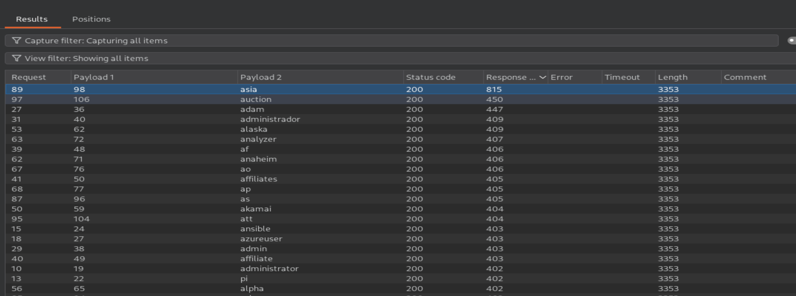
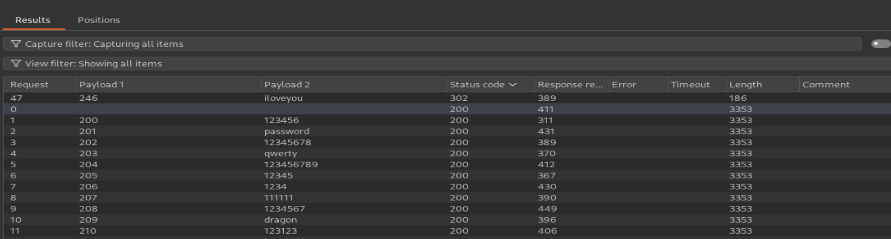
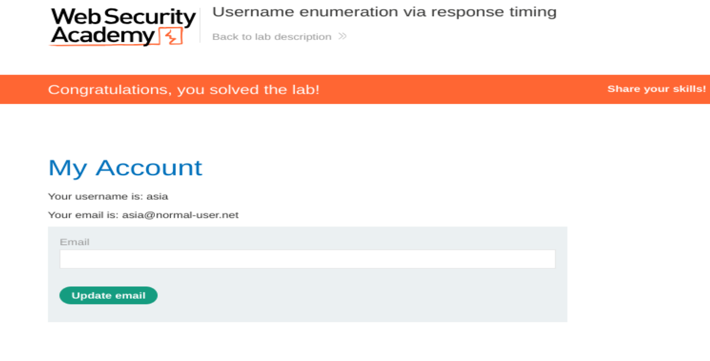

# Authentication: Username Enumeration via Response Timing

## Lab Information
- **Platform:** PortSwigger Web Security Academy
- **Category:** Authentication
- **Difficulty:** Apprentice
- **Status:** Solved
- **Tools:** Burp Suite Proxy, Burp Suite Repeater, Burp Suite Intruder

## Vulnerability Overview

Username enumeration via response timing occurs when an application takes different amounts of time to respond depending on whether a supplied username exists.

In this lab, valid usernames caused noticeably longer response times when a long password was submitted. The `X-Forwarded-For` HTTP header was also used to spoof IP addresses and bypass IP-based brute-force protection.

## Testing Process

1. Submit invalid login credentials and intercept the `POST /login` request using Burp Suite Proxy.
2. Send the request to Burp Suite Repeater and experiment with different usernames and passwords, observing response times.
3. Identify that the application supports the `X-Forwarded-For` header, which can be used to bypass IP-based brute-force protection by spoofing IP addresses.
4. Configure a Burp Suite Intruder **Pitchfork** attack with payload positions for the `X-Forwarded-For` header and username parameter.
5. Set a long password (approximately 100 characters) and configure the payloads:
   - Position 1: Numbers from 1 to 100 to spoof IP addresses.
   - Position 2: Candidate username list.
6. Run the attack and enable the **Response received** and **Response completed** columns to compare response timings.
7. Identify the username producing a significantly longer response time and repeat the request to confirm the timing difference.
8. Create another Pitchfork attack using the identified username, with payload positions for the IP address and password parameters.
9. Load the number range for IP spoofing and the candidate password list. Run the attack and identify the response with HTTP status code `302`.
10. Log in using the identified credentials and access the user account page to confirm successful lab completion.

## Evidence

### Username Enumeration

### Password Attack

### Lab Completion

## Impact

- Reveals valid usernames through differences in authentication response times.
- Can facilitate targeted password-guessing attacks.
- Weak IP-based brute-force protection can be bypassed through IP spoofing.
- Increases the risk of unauthorised account access.

## Remediation

- Ensure authentication responses have consistent processing times regardless of username validity.
- Do not trust client-supplied `X-Forwarded-For` headers for security decisions.
- Configure trusted proxies to correctly validate forwarded IP addresses.
- Implement robust rate limiting and account-level brute-force protection.
- Monitor suspicious authentication activity.
- Implement multi-factor authentication (MFA).

## References

- [PortSwigger: Username Enumeration via Response Timing](https://portswigger.net/web-security/authentication/password-based/lab-username-enumeration-via-response-timing)
- [OWASP: Authentication Cheat Sheet](https://cheatsheetseries.owasp.org/cheatsheets/Authentication_Cheat_Sheet.html)