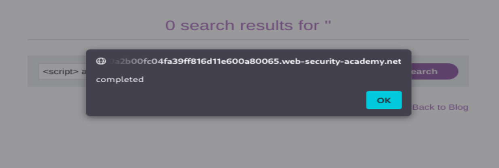
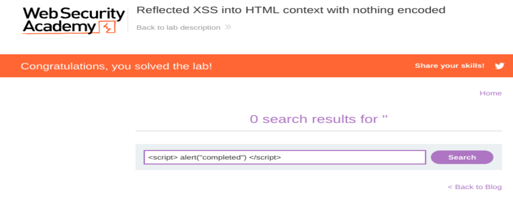

    # Cross-Site Scripting (XSS): Reflected XSS into HTML Context with Nothing Encoded

## Lab Information

- **Platform:** PortSwigger Web Security Academy
- **Category:** Cross-Site Scripting (XSS)
- **Difficulty:** Apprentice
- **Status:** Solved
- **Tools:** Web Browser

## Vulnerability Overview

Cross-Site Scripting (XSS) vulnerabilities occur when applications include untrusted user input in web pages without properly encoding or sanitizing it, allowing attackers to execute malicious JavaScript in the victim's browser.

In this lab, the application reflected user-supplied search input directly into the HTML response without performing any encoding or sanitization. By injecting a JavaScript payload using the `<script>` tag, it was possible to execute arbitrary JavaScript in the browser.

## Testing Process

1. Browse the application and locate the search functionality.
2. Enter the following payload into the search box:
```html
<script>alert(1)</script>
```
3. Click the **Search** button to submit the payload.
4. Observe that the application reflects the injected payload into the HTML response without encoding it.
5. The browser executes the injected JavaScript and displays an alert box containing `1`.
6. Successfully complete the lab.

## Evidence

**### JavaScript Alert Execution**



**### Lab Completion**



## Impact

- Allows attackers to execute arbitrary JavaScript in a victim's browser.
- Can potentially expose sensitive information accessible to the victim's browser.
- May enable unauthorized actions on behalf of authenticated users.
- Can be used for phishing attacks and website content manipulation.

## Remediation

- Apply context-appropriate output encoding to all untrusted user input.
- Avoid inserting untrusted input directly into HTML.
- Sanitize user-supplied HTML when HTML input is required.
- Use secure templating frameworks with automatic output encoding.
- Implement Content Security Policy (CSP) as an additional layer of protection.

## References

- [PortSwigger: Cross-Site Scripting](https://portswigger.net/web-security/cross-site-scripting)
- [PortSwigger: Reflected XSS into HTML Context with Nothing Encoded](https://portswigger.net/web-security/cross-site-scripting/reflected/lab-html-context-nothing-encoded)
- [OWASP: Cross Site Scripting Prevention Cheat Sheet](https://cheatsheetseries.owasp.org/cheatsheets/Cross_Site_Scripting_Prevention_Cheat_Sheet.html)