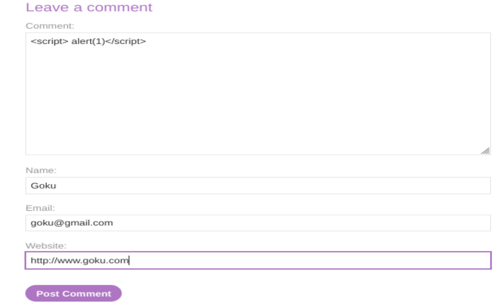
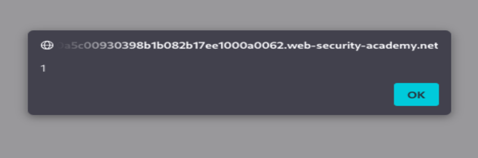
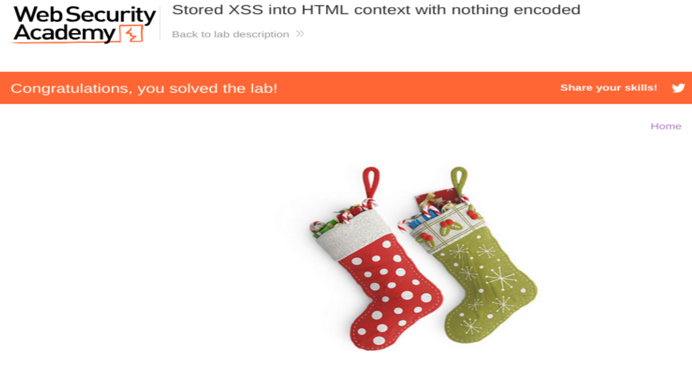

# Cross-Site Scripting (XSS): Stored XSS into HTML Context with Nothing Encoded

## Lab Information

- **Platform:** PortSwigger Web Security Academy
- **Category:** Cross-Site Scripting (XSS)
- **Difficulty:** Apprentice
- **Status:** Solved
- **Tools:** Web Browser

## Vulnerability Overview

Cross-Site Scripting (XSS) vulnerabilities occur when applications include untrusted user input in web pages without properly encoding or sanitizing it, allowing attackers to execute malicious JavaScript in visitors' browsers.

Stored XSS occurs when malicious input is permanently stored by an application, such as in a database, and later displayed to other users without proper sanitization or output encoding.

In this lab, the application stored user-submitted comments without encoding or sanitizing the injected HTML and JavaScript. By submitting a comment containing a `<script>` tag, it was possible to execute JavaScript whenever the blog page displaying the comment was visited.

## Testing Process

1. Browse the application and navigate to a blog post containing the comment functionality.
2. Enter the following payload into the comment box:
```html
<script>alert(1)</script>
```
3. Enter a name, email address, and website in the corresponding fields.
4. Click **Post comment** to submit the comment.
5. Navigate back to the blog post.
6. Observe that the stored JavaScript payload executes when the blog page loads, displaying an alert box containing `1`.
7. Successfully complete the lab.

## Evidence

**### Comment with XSS Payload**



**### JavaScript Alert Execution on Blog Page**



**### Lab Completion**



## Impact

- Allows attackers to execute arbitrary JavaScript in visitors' browsers.
- Can affect multiple users who visit the page containing the malicious comment.
- May expose sensitive information accessible to the victim's browser.
- Can enable unauthorized actions on behalf of authenticated users.
- Can be exploited for phishing and website content manipulation.

## Remediation

- Apply context-appropriate output encoding to all untrusted user input.
- Sanitize user-submitted HTML using a trusted HTML sanitization library when HTML input is required.
- Avoid directly inserting untrusted input into HTML documents.
- Use secure templating frameworks with automatic output encoding.
- Implement Content Security Policy (CSP) as an additional layer of protection.

## References

- [PortSwigger: Cross-Site Scripting](https://portswigger.net/web-security/cross-site-scripting)
- [PortSwigger: Stored XSS into HTML Context with Nothing Encoded](https://portswigger.net/web-security/cross-site-scripting/stored/lab-html-context-nothing-encoded)
- [OWASP: Cross Site Scripting Prevention Cheat Sheet](https://cheatsheetseries.owasp.org/cheatsheets/Cross_Site_Scripting_Prevention_Cheat_Sheet.html)