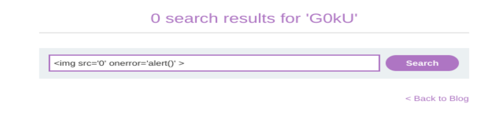
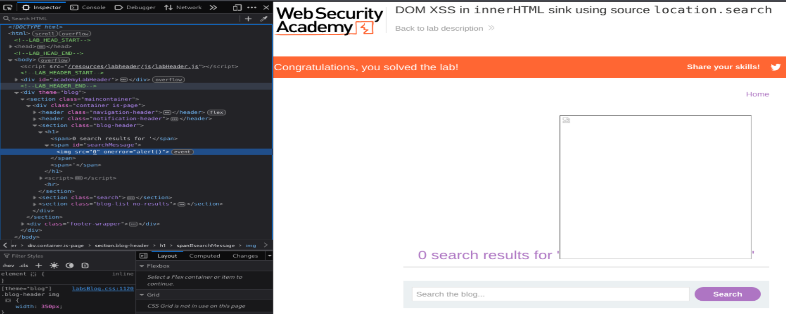

# Cross-Site Scripting (XSS): DOM XSS in `innerHTML` Sink Using Source `location.search`

## Lab Information

- **Platform:** PortSwigger Web Security Academy
- **Category:** Cross-Site Scripting (XSS)
- **Difficulty:** Apprentice
- **Status:** Solved
- **Tools:** Web Browser

## Vulnerability Overview

DOM-based Cross-Site Scripting (DOM XSS) occurs when client-side JavaScript processes untrusted data from a source and passes it to a dangerous sink without proper validation or sanitization.

In this lab, the application retrieved user-controlled input from the `location.search` source and passed it to the `innerHTML` sink. Since the application failed to properly sanitize the input, it was possible to inject HTML containing an event handler.

By injecting an `img` element with an invalid `src` attribute and an `onerror` event handler, it was possible to execute arbitrary JavaScript in the browser when the image failed to load.

## Testing Process

1. Browse the application and locate the search functionality.
2. Enter the following payload into the search box:
```html

```
3. Click the **Search** button to submit the payload.
4. Observe that the application processes the search input using client-side JavaScript and inserts it into the page through the `innerHTML` sink.
5. Since the `src` attribute contains an invalid image path, the browser triggers the `onerror` event handler when the image fails to load.
6. The event handler executes `alert(1)`, displaying an alert box containing `1`.
7. Successfully complete the lab.

## Evidence

**### Injected DOM XSS Payload**



**### JavaScript Alert Execution**


**### Lab Completion**



## Impact

- Allows attackers to execute arbitrary JavaScript in a victim's browser.
- May expose sensitive information accessible to the victim's browser.
- Can enable unauthorized actions on behalf of authenticated users.
- Can be exploited through specially crafted URLs distributed to victims.
- May compromise the security of users interacting with the vulnerable application.

## Remediation

- Avoid using `innerHTML` with untrusted user input.
- Use safe DOM manipulation methods such as `textContent` when inserting plain text.
- Apply context-appropriate output encoding.
- Sanitize untrusted HTML using a trusted HTML sanitization library when HTML input is required.
- Avoid passing user-controlled data directly into dangerous DOM sinks.
- Implement Content Security Policy (CSP) as an additional layer of protection.

## References

- [PortSwigger: DOM-Based XSS](https://portswigger.net/web-security/cross-site-scripting/dom-based)
- [PortSwigger: DOM XSS in innerHTML Sink Using Source location.search](https://portswigger.net/web-security/cross-site-scripting/dom-based/lab-innerhtml-sink)
- [OWASP: DOM Based XSS Prevention Cheat Sheet](https://cheatsheetseries.owasp.org/cheatsheets/DOM_based_XSS_Prevention_Cheat_Sheet.html)