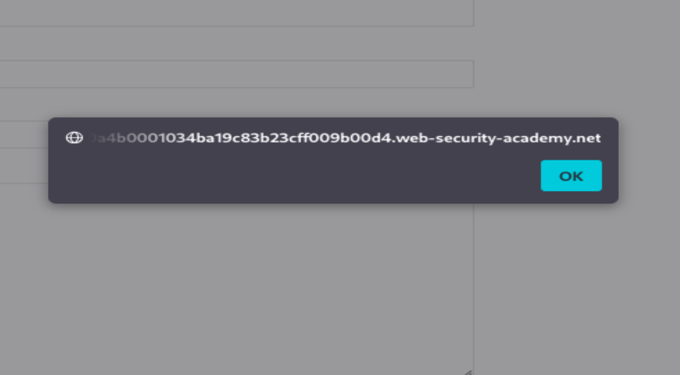
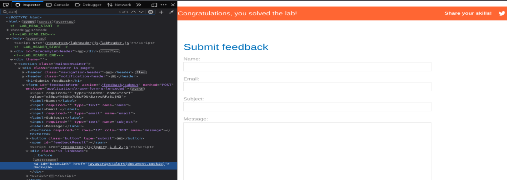

# Cross-Site Scripting (XSS): DOM XSS in jQuery Anchor `href` Attribute Sink Using Source `location.search`

## Lab Information

- **Platform:** PortSwigger Web Security Academy
- **Category:** Cross-Site Scripting (XSS)
- **Difficulty:** Apprentice
- **Status:** Solved
- **Tools:** Web Browser, Browser Developer Tools

## Vulnerability Overview

DOM-based Cross-Site Scripting (DOM XSS) occurs when client-side JavaScript processes untrusted data from a source and passes it to a dangerous sink without proper validation or sanitization.

In this lab, the application used the `location.search` source to retrieve the `returnPath` query parameter and passed the user-controlled value into the `href` attribute of an anchor element using jQuery.

Since the application failed to validate the URL scheme, it was possible to inject a `javascript:` URL into the `href` attribute. When the user clicked the affected link, the browser executed the injected JavaScript.

## Testing Process

1. Browse the application and navigate to the **Submit feedback** page.
2. Modify the `returnPath` query parameter by setting its value to `/` followed by a random alphanumeric string.
3. Right-click the page and select **Inspect** to open the browser's Developer Tools.
4. Inspect the relevant anchor element and observe that the supplied random string is inserted into its `href` attribute.
5. Modify the `returnPath` query parameter to the following payload:
```javascript
javascript:alert(document.cookie)
```
6. Press Enter to load the modified URL.
7. Click the **Back** link to trigger the injected JavaScript.
8. Observe that the browser executes the JavaScript and displays an alert box containing the document's cookies.
9. Successfully complete the lab.

## Evidence

**### Modified URL with JavaScript Payload**


**### JavaScript Alert Displaying Document Cookies**



**### Lab Completion**



## Impact

- Allows attackers to execute arbitrary JavaScript in a victim's browser.
- May expose sensitive information accessible through `document.cookie`.
- Can potentially compromise user sessions if session cookies are accessible to JavaScript.
- Can enable unauthorized actions on behalf of authenticated users.
- May be exploited through specially crafted URLs distributed to victims.

## Remediation

- Avoid assigning untrusted user input directly to anchor `href` attributes.
- Validate URL schemes and allow only trusted protocols such as `https:` and `http:` where appropriate.
- Reject dangerous schemes such as `javascript:`.
- Use safe DOM manipulation methods and validate URLs before assigning them to DOM attributes.
- Apply appropriate input validation and sanitization.
- Set sensitive session cookies with the `HttpOnly`, `Secure`, and appropriate `SameSite` attributes.

## References

- [PortSwigger: DOM-Based XSS](https://portswigger.net/web-security/cross-site-scripting/dom-based)
- [PortSwigger: DOM XSS in jQuery Anchor href Attribute Sink Using Source location.search](https://portswigger.net/web-security/cross-site-scripting/dom-based/lab-jquery-href-attribute-sink)
- [OWASP: DOM Based XSS Prevention Cheat Sheet](https://cheatsheetseries.owasp.org/cheatsheets/DOM_based_XSS_Prevention_Cheat_Sheet.html)