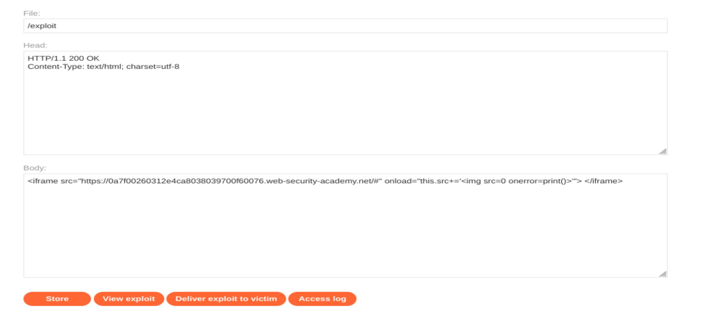
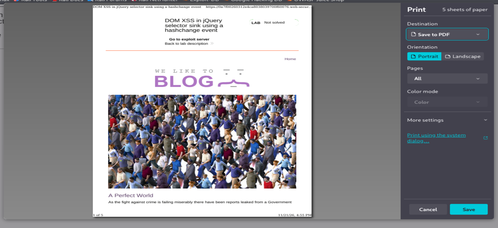
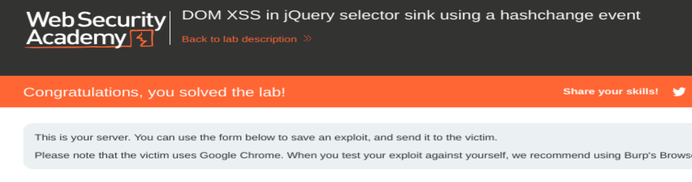

# Cross-Site Scripting (XSS): DOM XSS in jQuery Selector Sink Using a Hashchange Event

## Lab Information

- **Platform:** PortSwigger Web Security Academy
- **Category:** Cross-Site Scripting (XSS)
- **Difficulty:** Apprentice
- **Status:** Solved
- **Tools:** Burp Suite, Browser Developer Tools, Exploit Server

## Vulnerability Overview

DOM-based Cross-Site Scripting (DOM XSS) occurs when client-side JavaScript processes untrusted data from a source and passes it to a dangerous sink without proper validation or sanitization.

In this lab, the application used the `hashchange` event to process URL fragments and passed the user-controlled value to a jQuery selector. Since the application failed to properly validate the input, it was possible to manipulate the URL fragment to inject malicious HTML.

By hosting a specially crafted iframe on the exploit server, it was possible to trigger the vulnerable `hashchange` event and execute JavaScript in the victim's browser when they visited the exploit page.

## Testing Process

1. Browse the application's home page and inspect the client-side JavaScript using Burp Suite or the browser's Developer Tools.
2. Identify the vulnerable code that processes the URL fragment through a jQuery selector when the `hashchange` event occurs.
3. Open the **Exploit Server** using the link provided in the lab banner.
4. In the **Body** section, insert the following iframe payload, replacing `YOUR-LAB-ID` with the actual lab domain:
```html
<iframe src="https://YOUR-LAB-ID.web-security-academy.net/#" onload="this.src+=''"></iframe>
```
5. Click **Store** to save the exploit.
6. Click **View exploit** to test the payload and verify that the `print()` function is triggered.
7. Return to the Exploit Server and click **Deliver to victim**.
8. Successfully complete the lab.

## Evidence

**### Malicious iframe Payload on Exploit Server**



**### Print Function Execution**



**### Lab Completion**



## Impact

- Allows attackers to execute arbitrary JavaScript in a victim's browser.
- Can be exploited by delivering specially crafted URLs or malicious web pages to victims.
- May expose sensitive information accessible to the victim's browser.
- Can enable unauthorized actions on behalf of authenticated users.
- May compromise the security of users interacting with the vulnerable application.

## Remediation

- Avoid passing untrusted user input directly into jQuery selectors.
- Validate and sanitize URL fragments before processing them.
- Use safe DOM manipulation methods instead of dynamically constructing selectors from user-controlled input.
- Avoid using dangerous HTML insertion methods with untrusted data.
- Implement Content Security Policy (CSP) as an additional layer of protection.

## References

- [PortSwigger: DOM-Based XSS](https://portswigger.net/web-security/cross-site-scripting/dom-based)
- [PortSwigger: DOM XSS in jQuery Selector Sink Using a Hashchange Event](https://portswigger.net/web-security/cross-site-scripting/dom-based/lab-jquery-selector-hash-change-event)
- [OWASP: DOM Based XSS Prevention Cheat Sheet](https://cheatsheetseries.owasp.org/cheatsheets/DOM_based_XSS_Prevention_Cheat_Sheet.html)