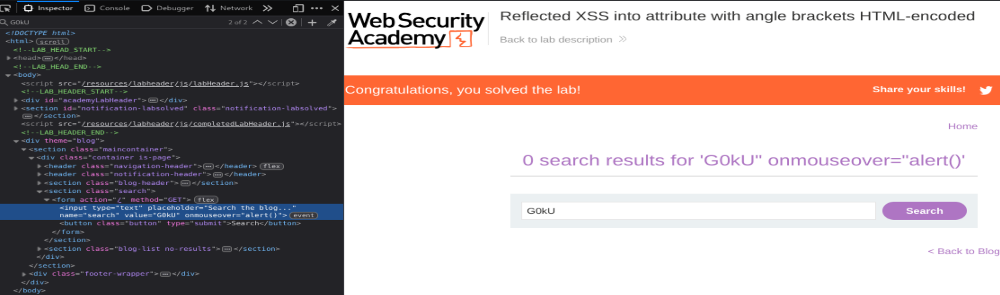

# Cross-Site Scripting (XSS): Reflected XSS into Attribute with Angle Brackets HTML-Encoded

## Lab Information

- **Platform:** PortSwigger Web Security Academy
- **Category:** Cross-Site Scripting (XSS)
- **Difficulty:** Apprentice
- **Status:** Solved
- **Tools:** Web Browser, Browser Developer Tools

## Vulnerability Overview

Reflected Cross-Site Scripting (XSS) occurs when an application includes user-supplied input in its HTTP response without properly handling it, allowing attackers to execute malicious JavaScript in a victim's browser.

In this lab, the application reflected user-controlled search input inside a quoted HTML attribute. Although angle brackets (`<` and `>`) were HTML-encoded, the application failed to properly encode quotation marks.

By injecting a payload that escaped the existing quoted attribute and introduced an `onmouseover` event handler, it was possible to execute JavaScript when the user moved their mouse over the affected element.

## Testing Process

1. Browse the application and enter a random alphanumeric string into the search box.
2. Right-click the page and select **Inspect** to open the browser's Developer Tools.
3. Inspect the relevant HTML element and observe that the search input is reflected inside a quoted HTML attribute.
4. Identify that angle brackets are HTML-encoded, but quotation marks are not properly encoded.
5. Replace the search input with the following payload:
```html
"onmouseover="alert(1)
```
6. Submit the payload through the search box.
7. Copy the resulting page URL by right-clicking and selecting **Copy URL**, then paste it into the browser's address bar and load the page.
8. Move the mouse pointer over the affected element.
9. Observe that the `onmouseover` event handler executes JavaScript and displays an alert box containing `1`.
10. Successfully complete the lab.

## Evidence

**### Reflected XSS Payload in HTML Attribute**


**### JavaScript Alert Execution on Mouseover**


**### Lab Completion**



## Impact

- Allows attackers to execute arbitrary JavaScript in a victim's browser.
- May expose sensitive information accessible to the victim's browser.
- Can enable unauthorized actions on behalf of authenticated users.
- Can be exploited through specially crafted URLs distributed to victims.
- May compromise the security of users interacting with the vulnerable application.

## Remediation

- Apply context-appropriate output encoding to all untrusted user input.
- Properly HTML-attribute-encode quotation marks and other special characters.
- Avoid dynamically inserting untrusted input into HTML attributes.
- Use safe DOM manipulation methods instead of constructing HTML from user-controlled data.
- Implement Content Security Policy (CSP) as an additional layer of protection.

## References

- [PortSwigger: Cross-Site Scripting](https://portswigger.net/web-security/cross-site-scripting)
- [PortSwigger: Reflected XSS into Attribute with Angle Brackets HTML-Encoded](https://portswigger.net/web-security/cross-site-scripting/contexts/lab-attribute-angle-brackets-html-encoded)
- [OWASP: Cross Site Scripting Prevention Cheat Sheet](https://cheatsheetseries.owasp.org/cheatsheets/Cross_Site_Scripting_Prevention_Cheat_Sheet.html)