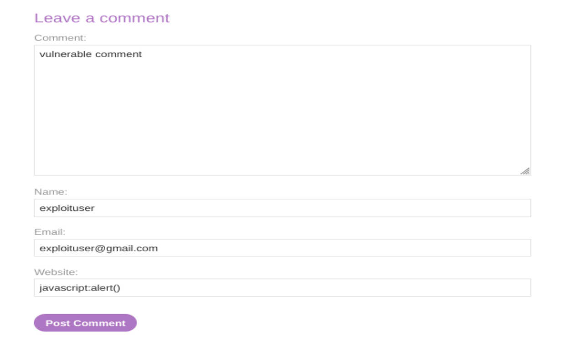
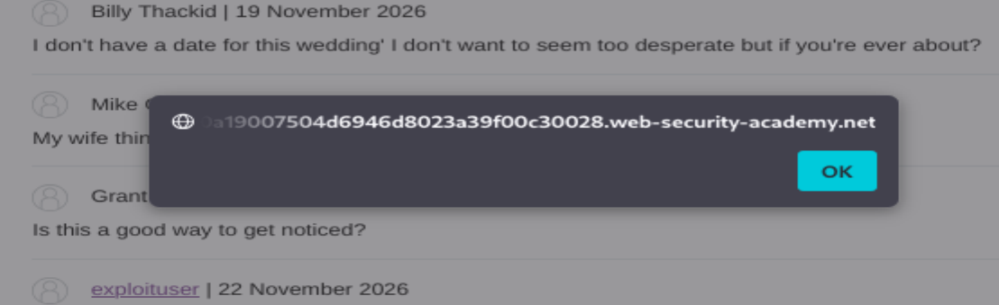
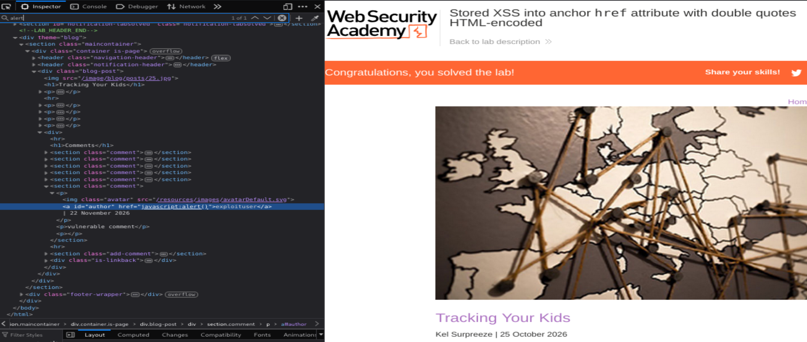

# Cross-Site Scripting (XSS): Stored XSS into Anchor `href` Attribute with Double Quotes HTML-Encoded

## Lab Information

- **Platform:** PortSwigger Web Security Academy
- **Category:** Cross-Site Scripting (XSS)
- **Difficulty:** Apprentice
- **Status:** Solved
- **Tools:** Web Browser, Browser Developer Tools

## Vulnerability Overview

Stored Cross-Site Scripting (XSS) occurs when an application stores user-supplied input and later displays it to other users without properly handling or validating the input, allowing attackers to execute malicious JavaScript in visitors' browsers.

In this lab, the application stored the website URL submitted through the comment form and later reflected it inside the `href` attribute of an anchor element. Although double quotes were HTML-encoded, the application failed to validate the URL scheme.

By injecting a `javascript:` URL into the website field, it was possible to execute JavaScript when a user clicked the link associated with the comment author's name.

## Testing Process

1. Browse the application and navigate to a blog post containing the comment functionality.
2. Enter a random alphanumeric string into the **Website** field and submit a comment with the required name and email details.
3. Return to the blog post and inspect the comment author's name using the browser's Developer Tools.
4. Observe that the submitted website value is reflected inside the `href` attribute of an anchor element.
5. Repeat the process, but this time enter the following payload in the **Website** field:

```javascript
javascript:alert(1)
```

6. Submit the comment and return to the blog post.
7. Inspect the author's name and verify that the injected JavaScript URL is present in the anchor element's `href` attribute.
8. Copy the resulting link URL and paste it into the browser's address bar to verify the URL.
9. Click the name displayed above your comment.
10. Observe that the browser executes the injected JavaScript and displays an alert box containing `1`.
11. Successfully complete the lab.

## Evidence

**### Stored JavaScript URL in Anchor href Attribute**



**### JavaScript Alert Execution on Link Click**



**### Lab Completion**




## Impact

- Allows attackers to execute arbitrary JavaScript in visitors' browsers.
- May expose sensitive information accessible to the victim's browser.
- Can enable unauthorized actions on behalf of authenticated users.
- May compromise user sessions if sensitive cookies are accessible to JavaScript.
- Can affect multiple visitors who interact with the malicious comment.

## Remediation

- Validate URL schemes before inserting user-supplied URLs into anchor `href` attributes.
- Allow only trusted URL schemes such as `https:` and `http:` where appropriate.
- Reject dangerous schemes such as `javascript:`.
- Apply context-appropriate output encoding to untrusted input.
- Sanitize and validate user-supplied data before storing and displaying it.
- Set sensitive session cookies with the `HttpOnly`, `Secure`, and appropriate `SameSite` attributes.

### References

- [PortSwigger: Stored Cross-Site Scripting](https://portswigger.net/web-security/cross-site-scripting/stored)
- [PortSwigger: Stored XSS into Anchor href Attribute with Double Quotes HTML-Encoded](https://portswigger.net/web-security/cross-site-scripting/contexts/lab-href-attribute-double-quotes-html-encoded)
- [OWASP: Cross Site Scripting Prevention Cheat Sheet](https://cheatsheetseries.owasp.org/cheatsheets/Cross_Site_Scripting_Prevention_Cheat_Sheet.html)
