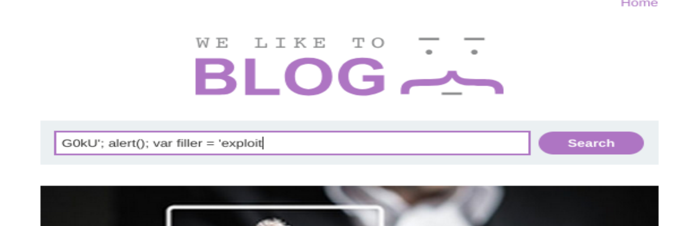
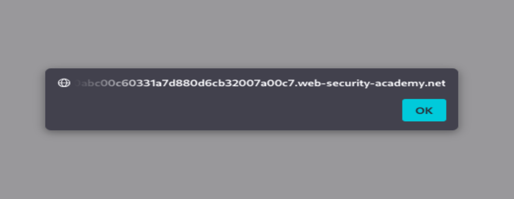
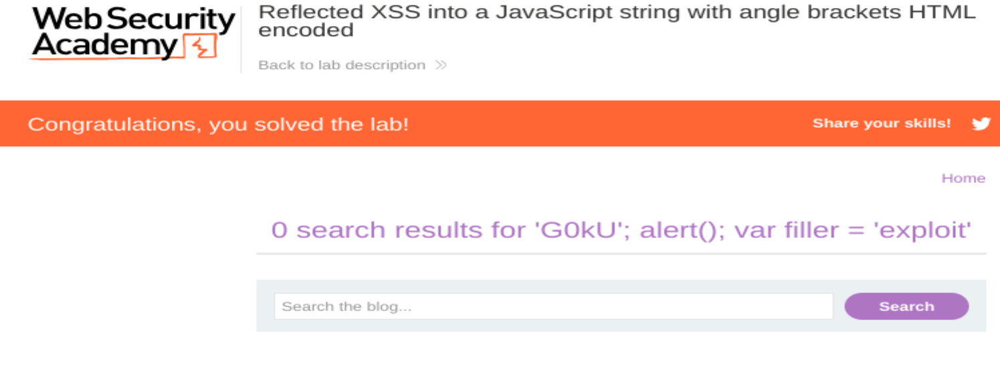

# Cross-Site Scripting (XSS): Reflected XSS into a JavaScript String with Angle Brackets HTML-Encoded

## Lab Information

- **Platform:** PortSwigger Web Security Academy
- **Category:** Cross-Site Scripting (XSS)
- **Difficulty:** Apprentice
- **Status:** Solved
- **Tools:** Web Browser, Browser Developer Tools

## Vulnerability Overview

Reflected Cross-Site Scripting (XSS) occurs when an application includes user-supplied input in its response without properly handling it, allowing attackers to execute malicious JavaScript in a victim's browser.

In this lab, the application reflected the search input inside a JavaScript string. Although angle brackets were HTML-encoded, the application failed to properly handle single quotes.

By injecting a payload that breaks out of the JavaScript string, it was possible to execute arbitrary JavaScript in the browser.

## Testing Process

1. Browse the application and locate the search functionality.
2. Enter a random alphanumeric string into the search box and submit the search.
3. Use the browser's Developer Tools to inspect the page and locate where the search input is reflected in the JavaScript code.
4. Observe that the input is reflected inside a JavaScript string.
5. Replace the search input with the following payload:

```javascript
'-alert(1)-'
```

6. Submit the payload using the search functionality.
7. Copy the resulting page URL and paste it into the browser's address bar.
8. Load the page and observe that the browser executes the injected JavaScript, displaying an alert box containing `1`.
9. Successfully complete the lab.

## Evidence

**### Injected Payload Reflected Inside JavaScript String**



**### JavaScript Alert Execution**



**### Lab Completion**



## Impact

- Allows attackers to execute arbitrary JavaScript in a victim's browser.
- May expose sensitive information accessible to the victim's browser.
- Can enable unauthorized actions on behalf of authenticated users.
- May be used for phishing attacks and website content manipulation.

## Remediation

- Apply context-specific output encoding when inserting untrusted input into JavaScript strings.
- Avoid directly embedding untrusted user input inside JavaScript code.
- Use safe data serialization techniques, such as `JSON.stringify()`, when passing data into JavaScript.
- Validate and sanitize user input where appropriate.
- Implement Content Security Policy (CSP) as an additional layer of protection.

## References

- [PortSwigger: Cross-Site Scripting](https://portswigger.net/web-security/cross-site-scripting)
- [PortSwigger: Reflected XSS into a JavaScript String with Angle Brackets HTML Encoded](https://portswigger.net/web-security/cross-site-scripting/contexts/lab-javascript-string-angle-brackets-html-encoded)
- [OWASP: Cross Site Scripting Prevention Cheat Sheet](https://cheatsheetseries.owasp.org/cheatsheets/Cross_Site_Scripting_Prevention_Cheat_Sheet.html)