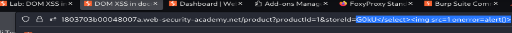
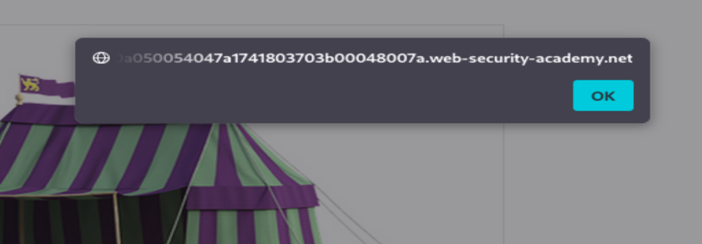
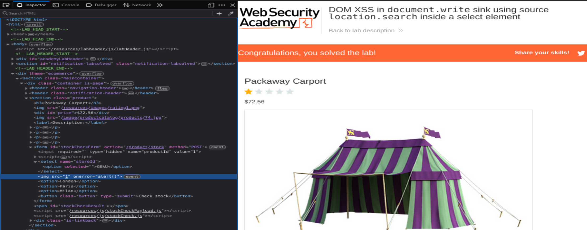

# Cross-Site Scripting (XSS): DOM XSS in `document.write` Sink Using Source `location.search` Inside a Select Element

## Lab Information

- **Platform:** PortSwigger Web Security Academy
- **Category:** Cross-Site Scripting (XSS)
- **Difficulty:** Apprentice
- **Status:** Solved
- **Tools:** Web Browser, Browser Developer Tools

## Vulnerability Overview

DOM-based Cross-Site Scripting (DOM XSS) occurs when client-side JavaScript processes untrusted data from a source and passes it to an unsafe sink, allowing attackers to execute malicious JavaScript in a victim's browser.

In this lab, the application extracts the `storeId` parameter from `location.search` and passes it to `document.write()` to dynamically create an option inside a stock checker select element.

Because the application does not properly handle the user-controlled input, it is possible to break out of the select element and inject an HTML element containing an event handler that executes JavaScript.

## Testing Process

1. Navigate to a product page and inspect the page's JavaScript using the browser's Developer Tools.
2. Identify the vulnerable JavaScript that extracts the `storeId` parameter from `location.search` and uses `document.write()` to create an option inside the stock checker select element.
3. Add a `storeId` query parameter to the product URL with a random alphanumeric value. For example:

```text
product?productId=1&storeId=test123
```

4. Load the modified URL and observe that the supplied value appears as an option in the stock checker drop-down list.
5. Right-click the drop-down list and inspect its HTML using Developer Tools. Confirm that the supplied value is inserted inside the select element.
6. Replace the random value with the following XSS payload:

```html
"></select>
```

7. Load the modified URL:

```text
product?productId=1&storeId="></select>
```

8. Observe that the payload breaks out of the select element and injects an image element with an invalid source.
9. The failed image load triggers the `onerror` event handler, causing the browser to execute JavaScript and display an alert box containing `1`.
10. Successfully complete the lab.

## Evidence

**### XSS Payload Injected Through the `storeId` URL Parameter**



**### Injected HTML Payload and JavaScript Alert Execution**



**### Lab Completion**



## Impact

- Allows attackers to execute arbitrary JavaScript in a victim's browser.
- May expose sensitive information accessible to the victim's browser.
- Can enable unauthorized actions on behalf of authenticated users.
- May be exploited through crafted URLs sent to unsuspecting users.
- Can compromise the integrity of the page by injecting malicious HTML content.

## Remediation

- Avoid using `document.write()` with untrusted user-controlled input.
- Use safer DOM APIs such as `document.createElement()` and `textContent` to create and populate elements.
- Apply context-appropriate output encoding to untrusted data.
- Validate user-controlled query parameters before processing them.
- Avoid inserting untrusted input into HTML parsing contexts.
- Implement Content Security Policy (CSP) as an additional layer of protection.

## References

- [PortSwigger: DOM-Based Cross-Site Scripting](https://portswigger.net/web-security/cross-site-scripting/dom-based)
- [PortSwigger: DOM XSS in `document.write` Sink Using Source `location.search` Inside a Select Element](https://portswigger.net/web-security/cross-site-scripting/dom-based/lab-document-write-sink-inside-select-element)
- [OWASP: DOM Based XSS Prevention Cheat Sheet](https://cheatsheetseries.owasp.org/cheatsheets/DOM_based_XSS_Prevention_Cheat_Sheet.html)