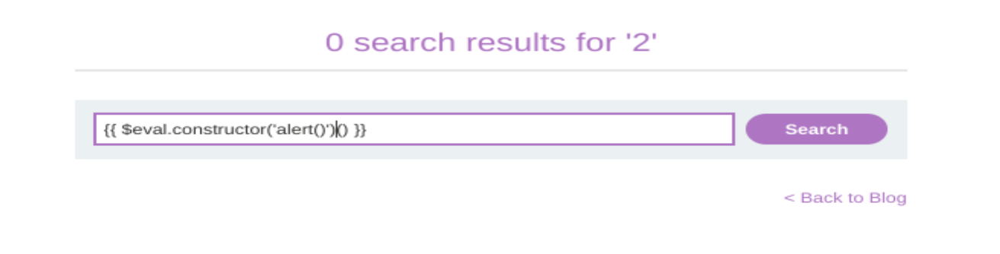
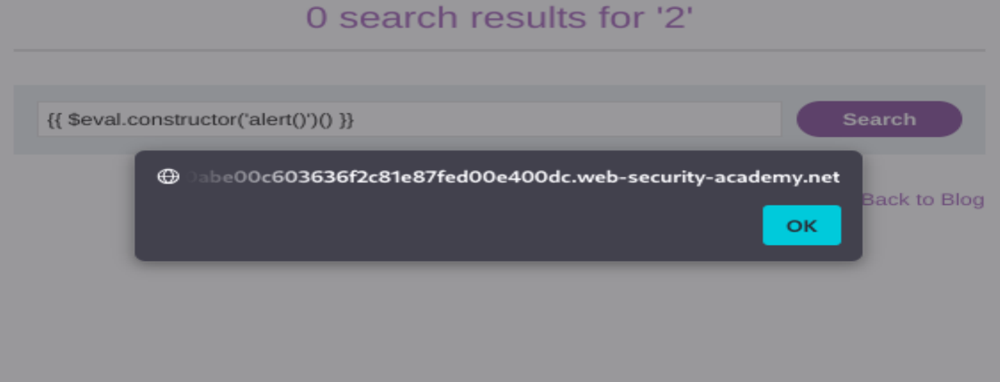

# Cross-Site Scripting (XSS): DOM XSS in AngularJS Expression with Angle Brackets and Double Quotes HTML-Encoded

## Lab Information

- **Platform:** PortSwigger Web Security Academy
- **Category:** Cross-Site Scripting (XSS)
- **Difficulty:** Practitioner
- **Status:** Solved
- **Tools:** Web Browser, Browser Developer Tools

## Vulnerability Overview

DOM-based Cross-Site Scripting (DOM XSS) occurs when client-side JavaScript processes untrusted input in an unsafe way, allowing attackers to execute malicious JavaScript in a victim's browser.

In this lab, the application reflects the search input inside an HTML element controlled by AngularJS through the `ng-app` directive. Although angle brackets and double quotes are HTML-encoded, the application fails to prevent AngularJS from evaluating user-controlled expressions.

By injecting an AngularJS expression, it is possible to execute arbitrary JavaScript without needing to inject new HTML elements or script tags.

## Testing Process

1. Browse the application and locate the search functionality.
2. Enter a random alphanumeric string into the search box and click **Search**.
3. View the page source and locate the reflected search input.
4. Observe that the input is enclosed within an element controlled by the AngularJS `ng-app` directive.
5. Replace the random string with the following AngularJS expression:

```javascript
{{$on.constructor('alert(1)')()}}
```

6. Click the **Search** button to submit the expression.
7. Observe that AngularJS evaluates the injected expression and executes the JavaScript.
8. A browser alert box containing `1` appears, confirming successful JavaScript execution.
9. Successfully complete the lab.

## Evidence

**### AngularJS Expression Injected Through the Search Functionality**



**### JavaScript Alert Execution**



**### Lab Completion**


## Impact

- Allows attackers to execute arbitrary JavaScript in a victim's browser.
- May expose sensitive information accessible to the victim's browser.
- Can enable unauthorized actions on behalf of authenticated users.
- May be exploited through crafted URLs or malicious input.
- Can compromise the integrity of the application and its user interface.

## Remediation

- Avoid compiling or evaluating untrusted user input as AngularJS expressions.
- Use AngularJS securely and avoid exposing user-controlled data to expression evaluation.
- Treat user input strictly as data rather than executable expressions.
- Apply context-appropriate output encoding.
- Upgrade to a supported and secure framework version where applicable.
- Implement Content Security Policy (CSP) as an additional layer of protection.

## References

- [PortSwigger: DOM-Based Cross-Site Scripting](https://portswigger.net/web-security/cross-site-scripting/dom-based)
- [PortSwigger: DOM XSS in AngularJS Expression with Angle Brackets and Double Quotes HTML-Encoded](https://portswigger.net/web-security/cross-site-scripting/dom-based/lab-angularjs-expression)
- [OWASP: DOM Based XSS Prevention Cheat Sheet](https://cheatsheetseries.owasp.org/cheatsheets/DOM_based_XSS_Prevention_Cheat_Sheet.html)