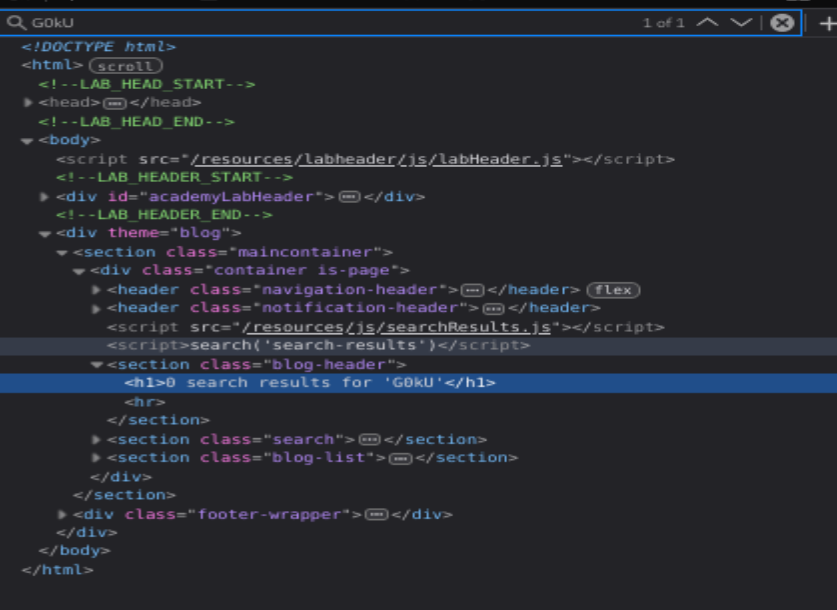
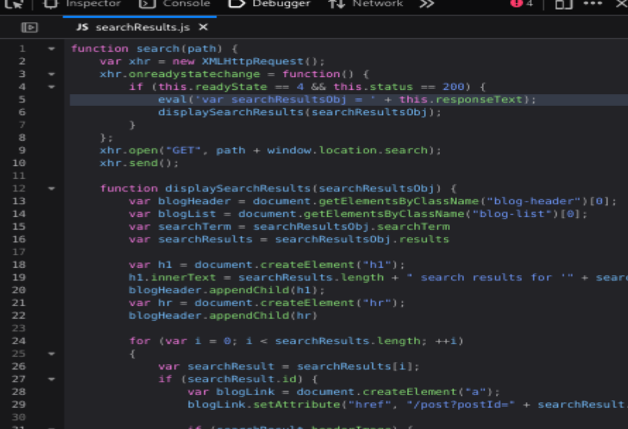
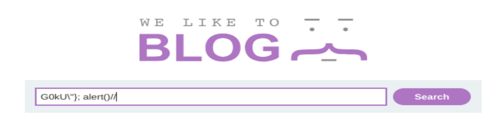

# Cross-Site Scripting (XSS): Reflected DOM XSS

## Lab Information

- **Platform:** PortSwigger Web Security Academy
- **Category:** Cross-Site Scripting (XSS)
- **Difficulty:** Practitioner
- **Status:** Solved
- **Tools:** Burp Suite (Proxy, Repeater, Site Map)

## Vulnerability Overview

Reflected DOM-based Cross-Site Scripting (DOM XSS) occurs when data from an HTTP response is processed by client-side JavaScript in an unsafe manner, allowing attackers to execute malicious JavaScript in a victim's browser.

In this lab, the application reflected the search term inside a JSON response named `search-results`. The client-side JavaScript file `searchResults.js` processed this response using `eval()`.

Although the application escaped quotation marks in the reflected search term, it failed to escape backslashes. By injecting a backslash, it was possible to interfere with the escaping mechanism, break out of the intended JavaScript string and execute arbitrary JavaScript.

## Testing Process

1. Open Burp Suite and navigate to **Proxy**. Make sure that Intercept is switched on.
2. Return to the lab and search for a random test string, such as:

```text
XSS
```

3. Go back to Burp Suite and forward the intercepted request.
4. Inspect the response and locate the JSON response named `search-results`. Observe that the search term is reflected in the response.
5. Navigate to the **Site Map** in Burp Suite and locate the `searchResults.js` file.
6. Inspect the JavaScript and identify that the JSON response is processed using an `eval()` function call.
7. Experiment with different search inputs and observe that quotation marks are escaped, but backslashes are not properly escaped.
8. Enter the following payload into the search box:

```javascript
\"-alert(1)}//
```

9. Submit the search request.
10. Observe that the injected backslash interferes with the application's quotation mark escaping. This allows the injected expression to break out of the intended string and execute `alert(1)`.
11. Successfully complete the lab.

## Evidence

**### Search Term Reflected in the JSON Response**



**### Vulnerable `eval()` Usage in searchResults.js**



**### Injected XSS Payload**



**### JavaScript Alert Execution**


**### Lab Completion**


## Impact

- Allows attackers to execute arbitrary JavaScript in a victim's browser.
- May expose sensitive information accessible to the victim's browser.
- Can enable unauthorized actions on behalf of authenticated users.
- May be exploited through specially crafted URLs sent to unsuspecting users.
- Can compromise the integrity of the application and its user interface.

## Remediation

- Avoid using `eval()` to process JSON or other untrusted data.
- Use `JSON.parse()` to parse JSON responses safely.
- Properly escape backslashes, quotation marks and other special characters when serializing data.
- Apply context-appropriate output encoding.
- Treat all data received from HTTP responses as untrusted.
- Implement Content Security Policy (CSP) as an additional layer of protection.

## References

- [PortSwigger: DOM-Based Cross-Site Scripting](https://portswigger.net/web-security/cross-site-scripting/dom-based)
- [PortSwigger: Reflected DOM XSS](https://portswigger.net/web-security/cross-site-scripting/dom-based/lab-dom-xss-reflected)
- [OWASP: DOM Based XSS Prevention Cheat Sheet](https://cheatsheetseries.owasp.org/cheatsheets/DOM_based_XSS_Prevention_Cheat_Sheet.html)