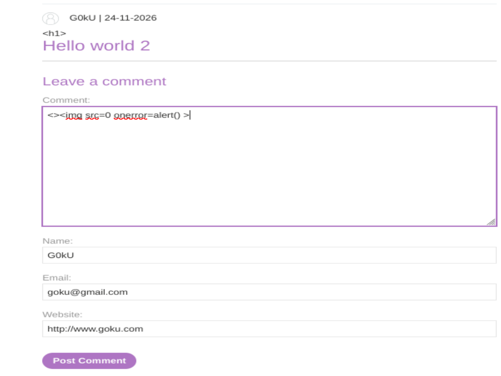
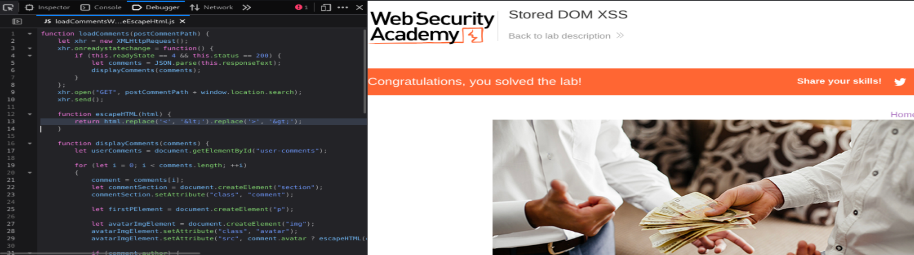

# Cross-Site Scripting (XSS): Stored DOM XSS

## Lab Information

- **Platform:** PortSwigger Web Security Academy
- **Category:** Cross-Site Scripting (XSS)
- **Difficulty:** Practitioner
- **Status:** Solved
- **Tools:** Web Browser

## Vulnerability Overview

Stored DOM-based Cross-Site Scripting (DOM XSS) occurs when an application stores user-supplied input and later processes it through vulnerable client-side JavaScript, allowing attackers to execute malicious JavaScript in visitors' browsers.

In this lab, the application uses JavaScript's `replace()` function in an attempt to encode angle brackets in user-submitted comments. However, because the function is called with a string as its first argument, it replaces only the first occurrence.

By adding an extra pair of angle brackets at the beginning of the comment, it is possible to bypass this incomplete filtering and inject an HTML element containing a JavaScript event handler.

## Testing Process

1. Navigate to a blog post containing the comment functionality.
2. Enter the following payload into the comment field:

```html
<>
```

3. Fill in the required name, email and other comment details.
4. Submit the comment.
5. Observe that the application attempts to encode the first occurrence of angle brackets using JavaScript's `replace()` function.
6. The initial angle brackets are encoded, but the subsequent angle brackets remain unaffected because only the first occurrence is replaced.
7. The injected `img` element is therefore interpreted as HTML by the browser.
8. Since the image source is invalid, the `onerror` event handler executes and displays an alert box containing `1`.
9. Successfully complete the lab.

## Evidence

**### Stored XSS Payload Submitted Through the Comment Form**



**### JavaScript Alert Execution**


**### Lab Completion**



## Impact

- Allows attackers to execute arbitrary JavaScript in visitors' browsers.
- Can affect multiple users who view the malicious comment.
- May expose sensitive information accessible to the victim's browser.
- Can enable unauthorized actions on behalf of authenticated users.
- May be exploited to manipulate page content or conduct phishing attacks.

## Remediation

- Avoid relying on `replace()` with a string argument when all occurrences must be replaced.
- Use appropriate output encoding for the context in which user input is inserted.
- Prefer safe DOM APIs such as `textContent` instead of inserting untrusted input as HTML.
- Sanitize user-submitted HTML using a trusted HTML sanitization library when HTML input is required.
- Treat stored user input as untrusted whenever it is rendered.
- Implement Content Security Policy (CSP) as an additional layer of protection.

## References

- [PortSwigger: DOM-Based Cross-Site Scripting](https://portswigger.net/web-security/cross-site-scripting/dom-based)
- [PortSwigger: Stored DOM XSS](https://portswigger.net/web-security/cross-site-scripting/dom-based/lab-dom-xss-stored)
- [MDN: String.prototype.replace()](https://developer.mozilla.org/en-US/docs/Web/JavaScript/Reference/Global_Objects/String/replace)
- [OWASP: DOM Based XSS Prevention Cheat Sheet](https://cheatsheetseries.owasp.org/cheatsheets/DOM_based_XSS_Prevention_Cheat_Sheet.html)