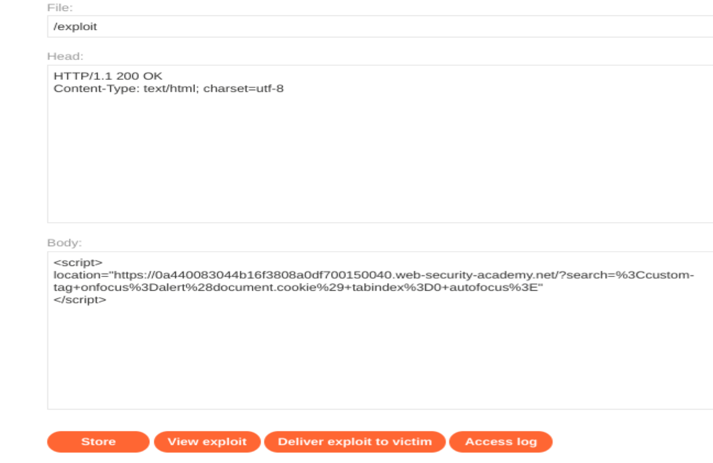
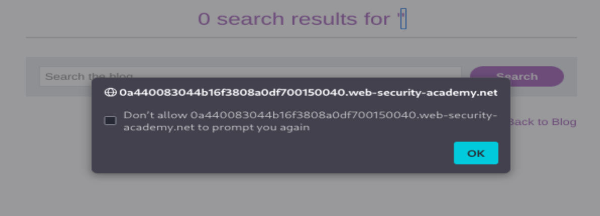
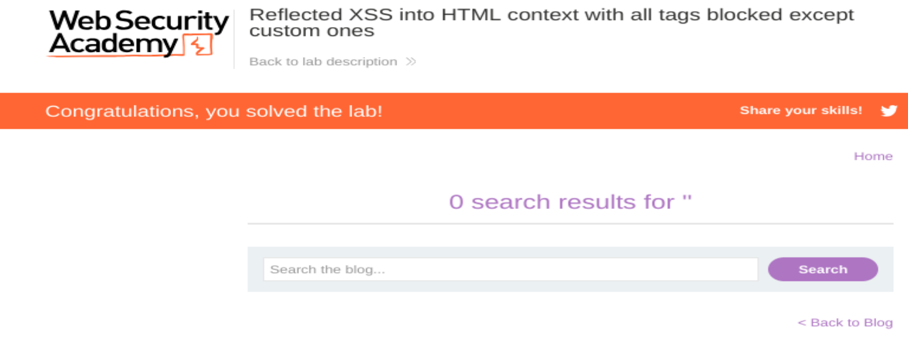

# Cross-Site Scripting (XSS): Reflected XSS into HTML Context with All Tags Blocked Except Custom Ones

## Lab Information

- **Platform:** PortSwigger Web Security Academy
- **Category:** Cross-Site Scripting (XSS)
- **Difficulty:** Practitioner
- **Status:** Solved
- **Tools:** Web Browser, Exploit Server

## Vulnerability Overview

Reflected Cross-Site Scripting (XSS) occurs when an application includes user-controlled input in an HTTP response without properly handling it, allowing attackers to execute JavaScript in a victim's browser.

In this lab, the application blocks standard HTML tags but permits custom HTML elements. By injecting a custom element with an `onfocus` event handler, it was possible to execute JavaScript when the element received focus.

The `autofocus` attribute automatically focuses the injected element when the page loads, triggering the event handler and executing the XSS payload.

## Testing Process

1. Navigate to the lab and identify the search functionality.
2. Open the Exploit Server.
3. Enter the following HTML, replacing the lab URL with the actual target:

   ```html
   <script>
   location="https://0a440083044b16f3808a0df700150040.web-security-academy.net/?search=%3Ccustom-tag+onfocus%3Dalert%28document.cookie%29+tabindex%3D0+autofocus%3E"
   </script>
   ```

4. The script redirects the browser to the vulnerable application with the XSS payload in the `search` parameter.
5. The URL-encoded payload decodes to:

   ```html
   <custom-tag onfocus=alert(document.cookie) tabindex=0 autofocus>
   ```

6. The application reflects the custom element into the HTML response.
7. The `autofocus` attribute causes the browser to focus the custom element when the page loads. The `onfocus` event handler then executes `alert(document.cookie)`.
8. Click **Store** to save the exploit.
9. Click **Deliver exploit to victim**.
10. The victim's browser loads the exploit, redirects to the vulnerable page, and triggers the JavaScript payload.
11. Successfully complete the lab.

## Evidence

**### Exploit Server Payload**



**### JavaScript Execution Through the onfocus Event**



**### Lab Completion**



## Impact

- Allows attackers to execute arbitrary JavaScript in a victim's browser.
- May expose sensitive information accessible to JavaScript, including cookies that are not protected by `HttpOnly`.
- Can enable unauthorized actions on behalf of authenticated users.
- Can be exploited by delivering a crafted link through an attacker-controlled page.

## Remediation

- Use context-appropriate output encoding for all untrusted input.
- Avoid relying solely on blocklists of standard HTML tags.
- If custom HTML elements are required, validate and restrict permitted elements and attributes.
- Remove or safely handle dangerous event handler attributes such as `onfocus`.
- Use a trusted HTML sanitization library when accepting HTML input.
- Implement Content Security Policy (CSP) as an additional layer of protection.

## References

- [PortSwigger Lab: Reflected XSS into HTML Context with All Tags Blocked Except Custom Ones](https://portswigger.net/web-security/cross-site-scripting/contexts/lab-html-context-with-all-standard-tags-blocked)
- [PortSwigger: Cross-Site Scripting](https://portswigger.net/web-security/cross-site-scripting)
- [PortSwigger: XSS Cheat Sheet](https://portswigger.net/web-security/cross-site-scripting/cheat-sheet)
- [OWASP: Cross Site Scripting Prevention Cheat Sheet](https://cheatsheetseries.owasp.org/cheatsheets/Cross_Site_Scripting_Prevention_Cheat_Sheet.html)